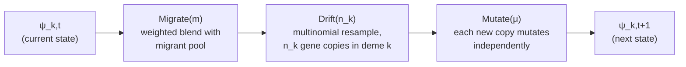
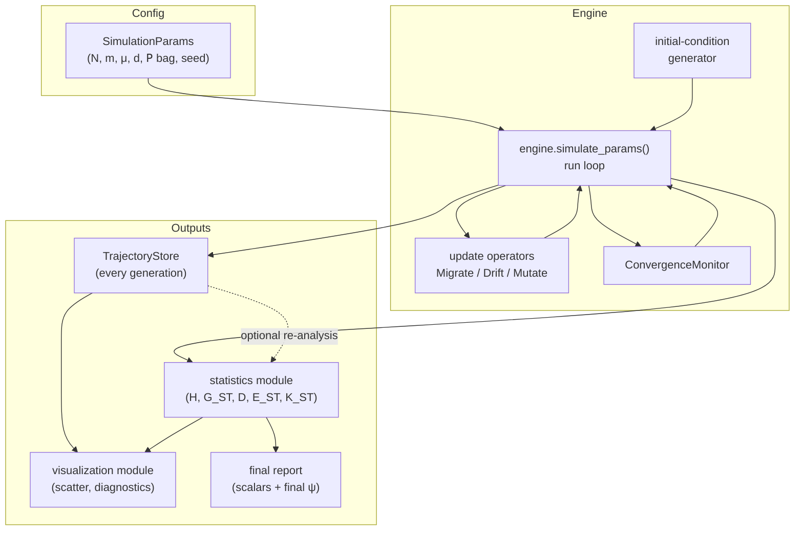
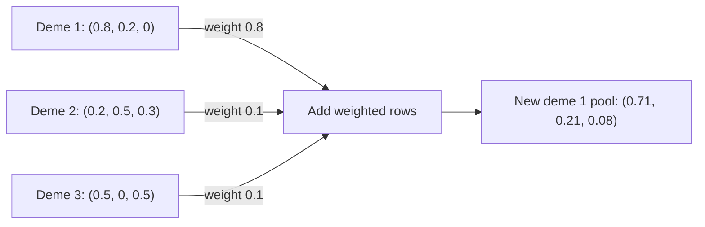

# Finite island model simulator: design document

- [Finite island model simulator: design document](#finite-island-model-simulator-design-document)
  - [Who this document is for](#who-this-document-is-for)
  - [1. Purpose and scope](#1-purpose-and-scope)
  - [2. Requirements](#2-requirements)
  - [3. The formal model](#3-the-formal-model)
    - [3.1 Signature and state](#31-signature-and-state)
    - [3.2 Alleles, loci, and identity](#32-alleles-loci-and-identity)
    - [3.3 Initial conditions](#33-initial-conditions)
    - [3.4 The generation-update pipeline](#34-the-generation-update-pipeline)
    - [3.5 What "converges" means here](#35-what-converges-means-here)
  - [4. System architecture](#4-system-architecture)
    - [4.1 Component overview](#41-component-overview)
    - [4.2 Data flow](#42-data-flow)
    - [4.3 The parameter bag (P)](#43-the-parameter-bag-p)
    - [4.4 Language and library choice](#44-language-and-library-choice)
    - [4.5 Packaging and distribution](#45-packaging-and-distribution)
    - [4.6 Choosing an engine backend](#46-choosing-an-engine-backend)
    - [4.7 The V engine as algebra on frequency tables](#47-the-v-engine-as-algebra-on-frequency-tables)
  - [5. Module layout](#5-module-layout)
  - [6. Persistence design](#6-persistence-design)
  - [7. Statistics module](#7-statistics-module)
    - [7.1 From matching pairs to differentiation](#71-from-matching-pairs-to-differentiation)
    - [7.2 A calculation that can be checked by hand](#72-a-calculation-that-can-be-checked-by-hand)
    - [7.3 Entropy, allele counts, and effective numbers](#73-entropy-allele-counts-and-effective-numbers)
  - [8. Visualization module](#8-visualization-module)
  - [9. Extensibility: where the next "what if" lands](#9-extensibility-where-the-next-what-if-lands)
    - [9.1 Variations reachable from configuration](#91-variations-reachable-from-configuration)
    - [9.2 Landing spots for changes that are not built](#92-landing-spots-for-changes-that-are-not-built)
  - [10. Validation and test strategy](#10-validation-and-test-strategy)
  - [11. Out of scope](#11-out-of-scope)
  - [12. Illustrated walkthrough](#12-illustrated-walkthrough)
    - [Installing it](#installing-it)
    - [Using it from the command line](#using-it-from-the-command-line)
  - [Appendix A. Graphical front-end sketches](#appendix-a-graphical-front-end-sketches)
  - [Appendix B. Engine backend benchmark results](#appendix-b-engine-backend-benchmark-results)
  - [Appendix C. Mathematical notation and algebra refresher](#appendix-c-mathematical-notation-and-algebra-refresher)
  - [Appendix D. Probability and sampling refresher](#appendix-d-probability-and-sampling-refresher)
  - [Appendix E. Linear algebra behind the V engine](#appendix-e-linear-algebra-behind-the-v-engine)
  - [Appendix F. Equilibrium, averaging, and uncertainty](#appendix-f-equilibrium-averaging-and-uncertainty)
  - [Metadata](#metadata)
    - [Revisions](#revisions)

## Who this document is for

Primarily written for whoever maintains or extends the simulator:
comfortable with software architecture; no recent mathematics or
population-genetics background is assumed. Appendices C–F refresh the
algebra, probability, linear algebra, and statistical ideas used here,
including material a reader may last have studied fifty years ago.
It is also the model and architecture reference for software a botanist
uses directly, so the prose stays readable for that reader as well. Not
every section needs to be; the table below says which do.

| If you are... | Read | Treat as optional |
|---|---|---|
| The botanist | §1, §2 (what the tool does), §4.5 (how to install and run it), §12 (a plain walkthrough — start here if you want the short version) | §3, §5, §6, §7, §9, §10 — internal architecture, informative but not required |
| The botanist, curious about a specific design choice | §4.7 (V-engine math), §7 (statistics), §8 (plots); Appendices C–F as needed | §5, §6, §9, §10 — module-level detail |
| Whoever maintains or extends the simulator | Everything, in order | — |

Sections written for the implementer are marked as such at their start;
skipping them costs nothing needed to follow §12's walkthrough.

Two companion documents in this directory —
[the finite island model introduction](finite-island-model-introduction.md)
and
[the Jost differentiation-measures guide](jost-differentiation-measures.md)
— supply the biological background and differentiation definitions.
This document builds the architecture on that foundation and derives the
mathematics needed to check its operations by hand. Start with §3.4 for
one generation, §4.7 for the V engine, and §7 for a worked statistics
calculation. The appendices are reference material, not prerequisites.

**Notation convention.** Mathematical quantities use TeX, such as $m$,
$p_{k,t,l}(a)$, and $G_{ST}$. Literal configuration keys, API parameters,
and report fields use code, such as `m`, `gene_copies`, and `G_ST`.
Thus the mutation probability $\mu$ is passed as `mu`. Every displayed
equation has an explicit, document-unique number; numbers do not depend
on a renderer maintaining a counter between math blocks.

Sections §4.3, §8, and §10 additionally cite one primary source directly:
`Dear-NolanMarch17Final.pdf`, an unpublished open letter from Lou Jost to
Nolan Kane, undated beyond its filename (internal references to Whitlock
(2011) place it in or after 2011). It answers a blog post with two worked
finite-island-model simulations, run by Anne Chao and T. C. Hsieh, and
reports their parameters, expected and observed statistic values, and
scatter plots. It is primary correspondence from the model's own author
rather than a peer-reviewed publication, and the sections below treat it
accordingly. The letter is not distributed with this repository; every
value taken from it appears in §4.3's table below, so no reader needs the
original to follow this document or the test plan that consumes the same
values.

## 1. Purpose and scope

A simulator for the finite island model (FIM) that a botanist — Lou Jost,
or a collaborator working in that tradition — uses to generate
known-ground-truth allele-frequency trajectories, then compute and inspect
population-differentiation statistics against that known history. The
motivating gap, per the companion introduction (§4 of that document): the
existing tools in this space
[`quantiNemo 2`](https://www2.unil.ch/popgen/softwares/quantinemo/),
[`hierfstat`](https://github.com/jgx65/hierfstat)) are built to
answer "what is the equilibrium statistic?", not "show me every
generation's allele frequencies" — and per-generation history is exactly
what this project exists to keep.

The core is a single, symmetric-island model ($N$, $m$, $\mu$ shared across
demes by default; one locus length $L$ shared across loci by default)
built so that further variations are extensions of the parameter set and
the update pipeline rather than rewrites of it. Section §9 maps every
"what if" this way, and separates the variations the simulator already
supports — unequal deme sizes, a general or spatial migration matrix,
per-locus length and mutation rate, stochastic migrant counts, a
finite-alleles mutation model, several simultaneous convergence
statistics, and adaptive replicate batching — from the ones that remain
deferred (§11).

## 2. Requirements

The simulator's functional requirements, restated for reference:

1. Simulate the FIM, with mathematical signature:

   ```math
   \mathrm{fim}(N,m,\mu,d;\mathsf P)\mapsto
   \{\psi_{k,t}:k\in\{1,\ldots,d\},\ t\in\mathbb Z_{\geq0}\} \tag{2.1}
   ```

   $N$, $m$, $\mu$, and $d$ are named model inputs; $\mathsf P$ is
   the further-parameter bag. $\psi_{k,t}$ is the state of deme $k$ at
   generation $t$, including the initial state at $t=0$.
   The run ends when a selected population statistic converges.
2. Alleles are an unordered, countably infinite set
   $\{a_j:j\in\mathbb Z_{>0}\}$ with identity comparison
   $\operatorname{same}(a_j,a_k)=(j=k)$ and no other structure
   — no ordering, no distance, no similarity.
3. Each allele belongs to a locus $l\in\mathbb Z_{>0}$ with length
   $L_l\in\mathbb Z_{>0}$. Length may vary independently per locus.
4. Initial allele-frequency distributions per deme may be random; the
   model is asserted to converge analytically for any starting
   population.
5. Every intermediate generation's state is persisted, and the converged
   final state is reported.
6. Botanist-facing output is (a) final population-differentiation metrics
   (scalars) and (b) per-deme allele-frequency distributions, with a
   canonical visual of a scatter plot of allele frequency in $d$-dimensional
   space.

Two places in this list carry real ambiguity, worth naming rather than
silently resolving:

- **"Locus" vs. "allele" as the length-bearer** (item 3). The companion
  differentiation-measures document (Part I) defines length as a property
  of the **locus** (the interval), not the allele (the value found there):
  $\mu\approx\mu_b L$ for a per-base-pair rate $\mu_b$. §3.2 below follows that
  document, representing $L_l$ with `LocusSpec.length`.
- **"Converges" applied to a stochastic process that has no fixed point**
  (item 1, item 4). Under the finite island model with $\mu>0$, no state
  is absorbing — allele frequencies keep moving forever, and the system
  settles into a *stochastic equilibrium*: the **distribution** of a
  summary statistic stabilizes, not the state itself. §3.5 makes this
  operational.

## 3. The formal model

*Implementer detail — optional for the botanist; §12 shows what this
adds up to in practice.*

### 3.1 Signature and state

Equation (2.1) gives the model signature. $\psi_{k,t}$ is deme $k$'s
complete state at generation $t$: one allele-frequency
vector per tracked locus.

```math
\psi_{k,t}=\{(l,p_{k,t,l}):l\in\text{Loci}\} \tag{3.1}
```

```math
p_{k,t,l}:\text{Allele}\to[0,1] \tag{3.2}
```

```math
\sum_a p_{k,t,l}(a)=1 \tag{3.3}
```

Read these three equations as a hierarchy of containers. Equation (3.1)
says that a deme's state contains one frequency distribution for each
locus. Equation (3.2) says that looking up an allele in one such
distribution returns a number between zero and one. Equation (3.3)
says that accounting for all alleles accounts for the entire locus:
their shares add to 100%. The sum runs over allele identities, not
over demes or generations.

For example, if deme 2 at generation 7 has locus 1 frequencies
$p_{2,7,1}(a)=0.6$ and $p_{2,7,1}(b)=0.4$, that locus's distribution
is the mapping $\{a\mapsto0.6,b\mapsto0.4\}$; an absent allele $c$
has frequency zero. A second locus contributes a separate mapping
to $\psi_{2,7}$. Its frequencies also sum to one on their own:
frequencies are not shared out between loci.

$p_{k,t,l}$ is a probability vector over whatever alleles are actually
present at locus $l$ in deme $k$ at generation $t$ — not over the whole
infinite allele universe. This is the load-bearing representational choice
(§3.2): the universe is unbounded, but after drift the *support* of
$p_{k,t,l}$ contains at most $n_k$ alleles, where $n_k$ is the deme's
gene-copy count. Generation 0 is an explicit exception (§3.3): its
continuous prior can specify more alleles than a sampled deme can hold.
The representation is finite even though its label space is not.

**The configuration counts individuals; the engine counts gene copies.**
The configuration key `N` gives individuals per deme; `ploidy` gives
copies per individual. Denote the latter by $c$:

```math
n_k=cN_k \tag{3.4}
```

Thus `N: 225`, `ploidy: diploid` gives $n_k=2\cdot225=450$.
`SimulationParams.from_mapping` performs this conversion once, and
the engine field is named `gene_copies`. The companion introduction's
diploid formulas use $2N$ where this document's sampling derivations
use $n$. Jost's letter uses haploid populations, so its $N=100$ and
$N=2000$ already equal the corresponding gene-copy counts.
The abstract signature (2.1) retains the historical symbol $N$;
subsequent sampling equations use $n_k$ to avoid that ambiguity.
See [the configuration reference](configuration.md) for accepted ploidies.

Equation (3.4) counts copies **at one locus**, not all DNA copies
across all tracked loci. A diploid deme of 225 individuals has 450
copies at locus 1 and another 450 at locus 2. Adding a second locus
does not double the population size supplied to either drift draw.
When deme sizes differ, perform the same conversion separately for
each $N_k$.

### 3.2 Alleles, loci, and identity

An allele is an opaque label with exactly one operation:
$\operatorname{same}(a_j,a_k)=(j=k)$.
No ordering, no metric, no structure — this is deliberate (the
differentiation-measures guide, "Distance between alleles is a different
model," is explicit that imposing a metric on alleles answers a different
question than the one this model and Jost's statistics are built for).
Implementation consequence: an allele is represented as an opaque integer
ID, nothing more — never a string, never a structured value that invites
comparison by anything other than equality.

New alleles are minted by mutation under the infinite-alleles assumption by
default (every mutation event produces a label never seen before — a good
approximation once a locus spans "many base pairs," per the
differentiation-measures guide). A single global `AlleleRegistry` hands out
the next unused integer on every mutation event across the whole run,
guaranteeing `same()` is exactly integer equality with no risk of two
independent mutations colliding on the same label.

An opt-in finite-alleles ($K$-allele) model (§9) relaxes that assumption for
loci short enough that it stops holding: each locus gets a bounded state
space of $4^{L_l}$ possible states, and a mutation event can *recur* to a
state already present elsewhere in the run rather than always minting
fresh. This still imposes no ordering or metric on
alleles — a K-allele target is chosen uniformly among the other `K - 1`
states, with no notion of one being "closer" to another — so it stays
inside the same distance-free identity model as the paragraph above, only
with a ceiling.

The power $4^{L_l}$ counts possible DNA strings, not the number of
alleles that must be present. For a two-base locus there are four
choices for the first base and four for the second, giving
$4\cdot4=16$ possible states. A deme may contain only two of them.
The finite-alleles model treats those states as 16 labels: a mutation
chooses one of the 15 alternatives uniformly, even if one candidate
sequence would differ at more bases than another. Thus this is not
a model of successive single-base edits.

A locus is a separate concept from an allele: it names *where* to look,
carrying its own identity $l\in\mathbb Z_{>0}$ and length $L_l\in\mathbb Z_{>0}$.
Length matters through the mutation rate ($\mu_l\approx\mu_b L_l$, per the differentiation-measures
guide) and, under the finite-alleles model only, through that state-space
ceiling; it plays no role in any statistic computed from a frequency
vector. It is represented as a LocusSpec(locus_id, length) value object,
with every run configuration providing one `LocusSpec` per tracked locus.
`length` may be equal across loci (the common case) or vary per locus
(§9); either way it is a data change, never a schema change.

### 3.3 Initial conditions

The per-deme, per-locus initial frequency vector $p_{k,0,l}$ is generated,
not hand-specified, by default: an i.i.d. symmetric Dirichlet draw over a
starting allele set, one draw per `(deme, locus)` pair, seeded from the
run's RNG seed for exact reproducibility. Concentration parameter and
starting allele count live in $\mathsf P$ (§4.3), not as hardcoded constants —
different concentration values produce visibly different starting
"evenness," which is itself a useful knob for a botanist probing the
model. An explicit, user-supplied $p_{0}$ is also accepted as an alternative
initial-condition source, for reproducing a specific published scenario or
a real allele-frequency survey as a starting point.

Here "i.i.d." means independent draws from the same distribution:
one deme's starting frequencies do not determine another's, but
every draw uses the same configured concentration. "Symmetric" means
that the starting alleles are treated alike, not that their realized
frequencies must be equal. With three starting alleles, rows such as
$(0.7,0.2,0.1)$ and $(0.2,0.3,0.5)$ can both come from that same
rule. Appendix D.5 shows how positive random weights are normalized
into these rows.

**Generation 0 is a continuous prior, not a state on the model's own
$1/n_k$ lattice.** Every generation from 1 onward is produced by `drift`
(§3.4), a multinomial resample at exactly $n_k$ gene copies, so every
frequency at generation 1 or later is a ratio of integers with
denominator $n_k$ — the only values $n_k$ gene copies can actually realize.
`DirichletInitialCondition`'s draw has no such constraint: a symmetric
Dirichlet distribution is continuous, so generation 0's frequencies
almost surely do *not* land on that lattice (an explicit, user-supplied
$p_{0}$ is not bound by it either). This is deliberate, not an oversight —
generation 0 represents the *belief* a starting frequency is drawn from,
not a sampled population state, and `drift`'s first application (to
produce generation 1) is what turns that belief into the model's first
actual $n_k$-gene-copy realization. A statistic computed at generation 0
(`fim stats --generation 0`) describes this continuous prior, not a
population; treat it accordingly rather than assuming it is comparable,
lattice-for-lattice, to every later generation.

For a ten-copy deme, the realizable frequency values are
$0,0.1,0.2,\ldots,1$. An initial frequency of $0.23$ is a valid
parental probability but would correspond to 2.3 observed copies,
which is impossible. The first drift draw might instead produce two
copies, or three, or another count; it does not round $0.23$ to the
nearest tenth. This is why keeping the distinction between an input
distribution and a sampled population matters.

Analytic convergence claims require assumptions about connectivity,
mutation, and the state being tracked; mutation alone does not prove
ergodicity for every possible configuration. Under infinite alleles,
stationarity concerns frequency or identity structure modulo relabeling,
not the ever-increasing registry counter. The simulator estimates an
equilibrium summary empirically; it does not prove convergence by
observing a short quiet interval (§3.5 and Appendix F).

One labeling detail worth being deliberate about: the founding allele set
at `t = 0` for each locus is assigned small, **locus-relative** IDs (`0,
1, …` up to initial_allele_count - 1) rather than draws from the same
global `AlleleRegistry` counter used for mutations. This is what keeps a
question like "did locus 1 and locus 2 fix on the same starting allele"
well-defined and cheap to answer — it reduces to comparing two small
integers — while every allele *born from a mutation event* still gets a
globally unique ID from the registry, so it can never be mistaken for one
of the founding alleles or for a mutant at another locus. Founding IDs and
minted IDs share one namespace (both are just `AlleleId` integers) but are
allocated from disjoint ranges so the two can never collide.

### 3.4 The generation-update pipeline

Per the finite-island-model introduction (§3.2), one generation is two
composed operators — migration (weighted blend) then drift (random
resampling) — with mutation as a documented optional third step
(introduction, §3.3), applied to the gene copies drift has just drawn:
each copy mutates independently with probability $\mu$, the textbook
Wright-Fisher model.

```math
p_{t+1}=\operatorname{Mutate}_\mu(\operatorname{Drift}_{\boldsymbol n}(\operatorname{Migrate}_m(p_t))) \tag{3.5}
```

Nested function notation is read from the inside out. Begin with
$p_t$, the collection of all current frequency rows. Apply migration
to obtain parental probabilities; apply drift to draw whole-copy
counts; then apply mutation to change labels on those copies.
$\boldsymbol n=(n_1,\ldots,n_d)^{\mathsf T}$ supplies the copy count
for each deme, rather than one count shared by all demes.
The output $p_{t+1}$ becomes the next generation's input.
Changing the order would change which objects are sampled and would
therefore define a different stochastic model.



Mutation acts on the sampled copies, not on the frequencies before
sampling. The following derivation makes that distinction concrete.
Fix one locus and generation; suppress $t$ and $l$ temporarily. Write
$n_k$ for the number of **gene copies at that locus in deme $k$**.
As in (3.4), $n_k=cN_k$, where $N_k$ is the number of individuals
in deme $k$ and $c$ is the number of copies per individual specified
by `ploidy` (1 for haploid, 2 for diploid).
This is the engine's `gene_copies` count, not the configuration's
individual count `N`. The index is a placeholder: $n_j$ in (3.6)
denotes the same count for deme $j$. Thus $S$ is the total number
of gene copies at this locus across all $d$ demes.

#### Migration: form the parental pool

For scalar migration $m$, the source pool excludes the destination.
With unequal deme sizes, source frequencies are weighted by gene-copy
count. First sum all copies carrying allele $a$, then remove the
destination's own contribution, then divide by the remaining copies:

```math
S=\sum_{j=1}^{d}n_j \tag{3.6}
```

```math
s_a=\sum_{j=1}^{d}n_jp_j(a) \tag{3.7}
```

Here $S$ counts **all gene copies at this locus, across all demes**,
regardless of which allele they carry. The smaller total $s_a$ counts
only the copies carrying **allele $a$**. To obtain that second total,
multiply each deme's copy count $n_j$ by its frequency $p_j(a)$,
then add those contributions. For example, a deme with 20 copies and
an allele frequency of $0.3$ contributes $20\cdot0.3=6$ copies of
allele $a$. For generation 0's continuous frequencies, these products
are copy-equivalent amounts rather than necessarily whole-copy counts.

The migrant pool for deme $k$ must exclude deme $k$ itself: a copy
already in the destination is not an incoming migrant. Equation (3.8)
therefore removes that deme from **both** totals before calculating
the external allele frequency:

```math
r_k(a)=\frac{s_a-n_kp_k(a)}{S-n_k}\quad(d>1) \tag{3.8}
```

Read the numerator as "copies of allele $a$ everywhere, minus copies
of allele $a$ in deme $k$." Read the denominator as "all copies
everywhere, minus all copies in deme $k$." Dividing gives $r_k(a)$:
the fraction of copies **outside deme $k$** that carry allele $a$.
Larger source demes contribute more copies automatically; this is
not an unweighted average of their frequencies.

For example, suppose $S=40$, $s_a=17$, and deme $k$ contains
$n_k=10$ copies with $p_k(a)=0.8$. That deme accounts for
$10\cdot0.8=8$ copies of allele $a$. Removing it leaves
$17-8=9$ copies of allele $a$ among $40-10=30$ external copies,
so $r_k(a)=9/30=0.3$. This is the source-pool frequency, not yet
the destination's new frequency. Equation (3.9) blends that pool
with the destination's retained local copies:

```math
q_k(a)=(1-m)p_k(a)+m r_k(a) \tag{3.9}
```

Here $r_k$ is the all-other-demes pool and $q_k$ is the parental
distribution after migration. Both terms in (3.9) are nonnegative.
Summing over alleles gives $(1-m)\cdot1+m\cdot1=1$.
For equal sizes, (3.8) is simply the average of the other $d-1$ rows.
For one deme there is no external pool: migration leaves its row unchanged.

The next equation defines **the same quantity** $q_k(a)$ — allele
$a$'s frequency in deme $k$'s parental pool after migration — but
allows a more general rule for where the incoming copies come from.
Equation (3.9) groups sources into two parts: the destination's own
copies, with weight $1-m$, and all other demes combined, with weight
$m$. The combined pool $r_k(a)$ already contains the relative
contributions of those other demes.

A full migration matrix makes those source contributions explicit,
one deme at a time. Entry $M_{kj}$ is the fraction of destination
$k$'s pool supplied by source $j$. The diagonal entry $M_{kk}$
is self-retention; the entries with $j\ne k$ describe incoming
contributions:

```math
q_k(a)=\sum_{j=1}^{d}M_{kj}p_j(a)\quad\left(M_{kj}\geq0,\ \sum_jM_{kj}=1\right) \tag{3.10}
```

To recover (3.9) from (3.10), choose $M_{kk}=1-m$ for the local
contribution and $M_{kj}=m n_j/(S-n_k)$ for each external source
$j\ne k$, as also recorded in (4.14). The external weights add to
$m$, because the external deme sizes add to $S-n_k$. Substituting
these weights into (3.10) gives the local term $(1-m)p_k(a)$ plus
an external sum. Factor $m/(S-n_k)$ out of that sum; what remains
is the external allele count $s_a-n_kp_k(a)$. The whole external
term is therefore $m r_k(a)$ by (3.8), reproducing (3.9).

For a numerical check, take three demes with gene-copy counts
$(10,20,10)$, allele-$a$ frequencies $(0.8,0.2,0.5)$, and
$m=0.2$. For destination 1, the other demes supply
$20\cdot0.2+10\cdot0.5=9$ allele-$a$ copies among 30 copies,
so $r_1(a)=0.3$. Equation (3.9) gives
$q_1(a)=0.8\cdot0.8+0.2\cdot0.3=0.70$.
The equivalent matrix row is $(0.8,2/15,1/15)$:
the larger external deme contributes twice the weight of the smaller.
Equation (3.10) then gives
$q_1(a)=0.8\cdot0.8+(2/15)\cdot0.2+(1/15)\cdot0.5=0.70$.
The two forms differ only in whether the external contributions are
grouped into one pool or written separately.

An arbitrary matrix need not use those size-based weights. It can,
for example, give a neighboring deme more influence than a distant
one or let migration differ by direction. Thus (3.10) is the general
weighted-sum rule, and (3.9) is its scalar-migration special case.
Matrix rows already specify the complete source weights; multiplying
them by deme sizes again would change the intended migration model.

So far, the migration fraction $m$ has been applied exactly every
generation. For example, $m=0.2$ means that the parental pool is
always 20% external and 80% local. The corresponding amount
$n_km$ need not be a whole number: with $n_k=12$, it is 2.4
copy-equivalents. That is valid for a continuous mixture of
frequencies, but it is not a count of individual migrant copies.

The option `migrant_sampling: stochastic` instead makes the
**number of incoming copies** random and whole-valued. Let $B_k$
be that count for destination deme $k$ in the current generation.
Imagine $n_k$ independent yes-or-no trials, one for each copy's
source: "external" has probability $m$, and "local" has probability
$1-m$. Count the external choices:

```math
B_k\sim\operatorname{Binomial}(n_k,m) \tag{3.11}
```

The symbol $\sim$ means "is drawn from the distribution"; it does
not mean that $B_k$ equals $n_km$. A binomial distribution assigns
probabilities to the possible counts $0,1,\ldots,n_k$.
Its expected count is $n_km$, but any particular draw must be a
whole number. Appendix D explains how these probabilities are
calculated and how a draw is made.

Equation (3.12) converts the drawn **count** back into a **fraction**
so it can be used in the same weighted-blend formula as before:

```math
\widehat m_k=\frac{B_k}{n_k} \tag{3.12}
```

The hat distinguishes the realized fraction $\widehat m_k$ from
the configured probability $m$. Its possible values are
$0,1/n_k,2/n_k,\ldots,1$. Substitute $\widehat m_k$ for $m$ in
(3.9): retain a fraction $1-\widehat m_k$ of the local composition
and mix in a fraction $\widehat m_k$ of the external pool.
No other part of that blend changes.

For example, take $n_k=10$, $m=0.2$, $p_k(a)=0.8$, and
$r_k(a)=0.3$. The expected migrant count is $10\cdot0.2=2$.
Suppose this generation's draw gives $B_k=3$ instead.
Then $\widehat m_k=3/10=0.3$: 30% of the parental pool is external,
and 70% is local. The resulting allele frequency is
$q_k(a)=0.7\cdot0.8+0.3\cdot0.3=0.65$.
The continuous blend gave $0.70$ for these same input frequencies;
this realization is lower because more copies came from the
external pool, where allele $a$ is less common.

Across repeated migration draws with the input frequencies held
fixed, the expected fraction is still $m$, since
$\mathbb E[\widehat m_k]=\mathbb E[B_k]/n_k=n_km/n_k=m$.
Because the blend is linear in that fraction, its expected
$q_k(a)$ equals the continuous result. This is agreement for the
**one-step migration expectation**, not a promise of identical
trajectories or identical long-run statistics under both settings.
The stochastic option adds variation around the continuous blend.

Only the **amount** of migration is sampled here. The external
allele composition $r_k$ remains the weighted average calculated
in (3.8); the migration step does not separately draw which alleles
the $B_k$ incoming copies carry. Thus its output can still contain
fractional copy-equivalents. The following drift step samples the
complete parental pool to produce an actual whole-copy population.
The same realized fraction $\widehat m_k$ is used for all loci of
destination $k$ in that generation, rather than drawing a separate
migrant count for each locus.

For stochastic matrix migration, the same reasoning starts from
the destination's total external weight $1-M_{kk}$ instead of a
shared scalar $m$. Draw $B_k$ with that probability, divide by
$n_k$, and use the result as the external fraction. To determine
the external composition, divide each off-diagonal weight $M_{kj}$
by $1-M_{kk}$: these conditional source weights sum to one among
the external demes. This separates "how much comes from outside?"
from "given that it comes from outside, which source contributes
what share?" If $1-M_{kk}=0$, no external copies are possible:
$B_k=0$, the row stays unchanged, and no division by the zero
external weight is needed.

#### Drift: draw whole gene copies

Let $a_1,\ldots,a_A$ be the alleles present in the parental pool.
Draw $n_k$ times with replacement, using $q_k$ as the probabilities:

```math
(C_{k1},\ldots,C_{kA})\sim\operatorname{Multinomial}(n_k;q_k(a_1),\ldots,q_k(a_A)) \tag{3.13}
```

Here $A$ is the number of allele categories in this pool, not a
population size. $C_{ki}$ counts how many of the $n_k$ offspring
copies receive allele $a_i$. A multinomial draw fills the whole
count row together: every copy receives exactly one label, so the
entries cannot vary independently. If one category receives more
copies, fewer remain for the others.

For ten copies and probabilities $(0.7,0.2,0.1)$, a possible result
is $(6,3,1)$; another is $(8,2,0)$. Both sum to ten. The zero in
the latter result means the third allele was lost from this deme
in that draw, even though its parental probability was positive.
"With replacement" means that choosing one parent does not remove
it from the pool: several offspring can choose the same parent.

The next equation converts each count back to a frequency. The
tilde marks the intermediate state **after drift but before mutation**:

```math
\widetilde p_k(a_i)=\frac{C_{ki}}{n_k} \tag{3.14}
```

Thus $(6,3,1)$ becomes $(0.6,0.3,0.1)$ by dividing every entry by ten.
Because the counts sum to $n_k$, their divided values sum to one
without a biological correction or the addition of missing copies.

The counts sum to $n_k$ exactly. Their mean reproduces the parental
pool, but a particular realization need not:

```math
\mathbb E[\widetilde p_k(a_i)\mid q_k]=q_k(a_i) \tag{3.15}
```

The symbol $\mathbb E$ means an average over possible draws, and
the vertical bar means "with the parental distribution $q_k$ held
fixed." Repeat this same one-step experiment many times, without
feeding one result into the next: the average frequency approaches
$q_k(a_i)$. For an allele with probability $0.7$ in a ten-copy
deme, the expected count is seven and the expected frequency is
$0.7$. Neither statement requires each draw to contain seven copies.

```math
\operatorname{Var}[\widetilde p_k(a_i)\mid q_k]=\frac{q_k(a_i)(1-q_k(a_i))}{n_k} \tag{3.16}
```

Variance is the average **squared** departure from that expected
frequency. For $q_k(a_i)=0.7$ and $n_k=10$, it is
$0.7\cdot0.3/10=0.021$. Its square root, approximately $0.145$,
is the standard deviation in frequency units. Raising the copy
count to 100 reduces the variance to $0.0021$ and the standard
deviation to approximately $0.0458$. Ten times as many copies
therefore reduce typical deviations by $\sqrt{10}$, not ten.
At probability zero or one the variance is zero: absent alleles
cannot be sampled, and a sole available allele receives every copy.

This is drift: the mean stays put while finite sampling produces
movement around it. Appendix D derives the sampling probabilities.

#### Mutation: relabel the sampled copies

Conditional on the post-drift counts, each allele independently loses
a binomial number of copies to mutation:

```math
U_{ki}\mid C_{ki}\sim\operatorname{Binomial}(C_{ki},\mu_l) \tag{3.17}
```

$U_{ki}$ is the number of copies **leaving their old allele label**,
not the count of copies entering a particular new label.
The conditioning bar says that the drift result $C_{ki}$ has
already been drawn and is now held fixed. The mutation probability
$\mu_l$ is per copy at locus $l$; the trial count is $C_{ki}$,
not the deme-wide count $n_k$ for every allele.
Using $n_k$ separately for every category would count the same
population repeatedly.

For a post-drift count of six and $\mu_l=0.1$, the expected number
leaving that label is $6\cdot0.1=0.6$. A realized count might be
zero, one, or another integer up to six. The fraction $0.6$ is
an expectation, not a fractional mutation event. A category with
zero copies contributes no mutations.

Under infinite alleles, the old allele retains $C_{ki}-U_{ki}$ copies,
and each of the $U_{ki}$ mutated copies gets its own new label and
frequency $1/n_k$. Under finite alleles, each mutated copy instead
chooses uniformly among the $K_l-1$ labels other than its parent.
Incoming mutations can therefore increase an existing allele's count.
In either case mutation changes labels, not the total number of copies.

The two models differ in how those outgoing copies are assigned.
Under infinite alleles, two mutated copies always receive different
new labels, even when they had the same parent allele. Under finite
alleles, both can choose the same target, and another old label can
receive incoming copies while losing some of its own. Consequently
"subtract outgoing mutations" completes the old-label calculation
only in the infinite-alleles case; finite alleles also require adding
incoming mutations, as in Appendix E.3.

For example, take $n_k=10$, parental probabilities $(0.7,0.2,0.1)$,
and a possible drift result $(6,3,1)$. If mutation counts are $(1,0,1)$,
the infinite-alleles result is $(5,3,0,1,1)$: the last two entries name
different new alleles. Dividing by ten gives $(0.5,0.3,0,0.1,0.1)$.
This is one possible realization, not the expected result and not a
claimed output for a particular seed.

For an isolated deme with $n\geq2$ under infinite alleles, let $F_t$ denote the
expected identity of two **distinct** copies. Two offspring choose
the same parent with probability $1/n$; otherwise their distinct
parents match with probability $F_t$. Both offspring must also avoid
mutation. Multiplication of these independent survival probabilities
gives:

```math
F_{t+1}=(1-\mu)^2\left[\frac1n+\left(1-\frac1n\right)F_t\right] \tag{3.18}
```

Read the bracket as two mutually exclusive ways to obtain identical
parental labels. First choose one parent; the second offspring
chooses that exact copy with probability $1/n$, and those labels
necessarily match. Otherwise, with probability $1-1/n$, the two
parents are distinct; their labels match with probability $F_t$.
Add those two cases. Finally, each offspring independently avoids
mutation with probability $1-\mu$, so multiply the bracket by
$(1-\mu)(1-\mu)$.

For example, let $n=10$, $F_t=0.5$, and $\mu=0.1$. Before mutation
the matching probability is $0.1+0.9\cdot0.5=0.55$.
Both offspring avoid mutation with probability $0.9^2=0.81$,
giving $F_{t+1}=0.81\cdot0.55=0.4455$.
This describes an expected matching probability across populations,
not an instruction to overwrite any allele frequency with $0.4455$.

This isolated-deme recursion is not a complete multi-deme recursion:
with migration, parent choices can come from different demes and
between-deme identities must also be tracked. Nor does it apply
unchanged to finite alleles, where independent mutations can match.
Appendix F solves (3.18) and distinguishes it from observed identity.

(Releases before this order was adopted ran Migrate → Mutate →
Drift with a mutation step that scaled every allele's frequency down in
proportion to a deme-wide event count; that is not the textbook model
and left an $O(\mu/n)$ excess identity each generation.)

Each stage has explicit state and parameter inputs; random stages
also receive random streams and consume draws from them. No
stage reads or mutates global simulation state, and each is independently
unit-testable against the closed-form expectations in the companion
documents (§10). Keeping the generative model and the statistic
computation as two separate concerns, and keeping each stage of the
generative model itself separately testable rather than one fused update
step, is what makes both halves easy to verify independently.
The V engine fuses execution for speed without changing this logical
order; §4.7 shows the corresponding algebra objects.

### 3.5 What "converges" means here

There is no fixed frequency state to reach once $\mu>0$ — frequencies
keep moving. Operationally the run discards a burn-in, then estimates
the equilibrium mean of each watched statistic until its error bar is
small enough and its effective sample size is large enough.
`BurnInMonitor` implements this within-run rule; `ConvergenceMonitor`
handles independent replicates (§5). A flat-looking short interval
does not establish equilibrium. Appendix F explains the distinction,
and [the convergence reference](convergence.md) specifies the stopping
policy.

A run can therefore be making useful progress even when its latest
$D$ value continues to rise and fall. The estimate of interest is
the average after burn-in, together with the uncertainty in that
average. A precision request of $0.01$ does not ask successive
generations to differ by less than $0.01$; it asks for an error-bar
half-width of at most $0.01$ around the reported equilibrium estimate.
The effective sample size accounts for the fact that nearby
generations contain overlapping information.

If $\mu=0$, loss of alleles can instead produce absorbing states.
Global fixation requires migration that actually connects the demes;
isolated demes can fix on different alleles. With infinite alleles and
positive mutation, absolute allele IDs continue to increase, so a
stationary distribution refers to diversity or frequency structure
modulo relabeling, not to the literal registry counter.

## 4. System architecture

### 4.1 Component overview

*§4.1–§4.4 are implementer detail — optional for the botanist; skip
ahead to §4.5 for what this means for installing and running the
software.*



`simulate_params()` owns the run loop; every other component is a function or
small class it calls, none of them aware of the loop that drives them.
`TrajectoryStore` and the statistics module are usable standalone against
a previously persisted run — re-computing a new statistic against an old
trajectory should never require re-running the simulation.

For example, the migration operator receives frequencies and produces
new frequencies; it need not know whether they will be plotted or
saved. The statistics module receives a frequency table and calculates
$D$; it need not know whether that table came from this simulator or
a survey. Keeping these boundaries explicit makes two independent
checks possible: test that the simulated population follows the model,
and separately test that the statistics correctly describe a supplied
population. Agreement between two components that share the same
mistake would not be an independent check.

### 4.2 Data flow

1. `SimulationParams` (validated) plus a seed produce an initial $\psi_0$ via
   the initial-condition generator (§3.3).
2. The run loop writes $\psi_0$ to the `TrajectoryStore`, then repeatedly
   applies the update pipeline (§3.4), writing each $\psi_t$ as it is
   produced, and feeding the chosen statistic's value at $\psi_t$ to the
   `BurnInMonitor`.
3. When the monitor signals stop (statistic converged) or a hard
   generation cap is hit (safety valve — see §5), the loop ends.
4. The statistics module computes the full final-generation report from
   $\psi_T$.
5. The visualization module reads from the `TrajectoryStore` (for the
   canonical scatter and any diagnostic plots) and from the final report.

One pass through this loop advances biological time by one generation,
not by one operator. The intermediate parental pool and post-drift
counts explain how the next state is produced; they are not three
additional generations. The state at generation $T$ answers "what
population was present when execution stopped?" The post-burn-in
average answers the different question "what statistic characterized
the sampled equilibrium history?" A final scatter and an equilibrium
average can therefore describe the same run without describing the
same mathematical object.

### 4.3 The parameter bag (P)

$\mathsf P$ is deliberately open — the requirement says so, and the pattern
across every companion document is "the botanist will keep asking to vary
one more thing." The design response: every value that varies by
scenario — not just the four named arguments — is a named entry in $\mathsf P$,
read at the point of use with an explicit default, and never a hardcoded
literal inside an operator or the run loop.

The table below is the architectural shape of $\mathsf P$, not its full key list;
[`doc/configuration.md`](configuration.md) is the authoritative reference
for every key, type, default, and validation rule, and is the one place
that has to change when a key is added.

| Key | Meaning | Default |
|---|---|---|
| `seed` | RNG seed for the whole run | required, no default |
| `n_loci` | number of independent loci tracked | `1` |
| `locus_lengths` | `LocusSpec.length` per locus | one shared constant |
| `initial_allele_count` | starting allele count per locus | `2` (biallelic/SNP-like) |
| `initial_concentration` | Dirichlet concentration for random start | `1.0` (uniform) |
| `deme_weighting` | `"equal"` or `"size"` — used only by $E_{ST}$; every other reported statistic ($D$, $G_{ST}$, $K_{ST}$, $H_{S}$, $H_{T}$, $H_{ST}$) always uses equal deme weighting regardless of this setting | `"size"` |
| `convergence_statistic` | which statistic(s) the monitor watches | `D` and `G_ST` |
| `convergence_burn_in` | generations discarded before averaging starts | derived from the model's relaxation time and precision |
| `precision` | plus or minus, in each watched statistic's units, at `confidence` | `0.01` |
| `max_generations` | hard safety cap | derived (burn-in plus fifteen relaxation times, at least 200,000) |

`N` and `m` each accept either a scalar (the symmetric case) or an
array/matrix (per-deme size, full or sparse migration matrix) — see §9.
Passing a richer value for either is a config change, not a new code path
threaded through the operators.

For example, an individual-count list `[100, 200, 100]` with
`ploidy: diploid` becomes gene-copy counts $(200,400,200)$.
Every drift draw uses its own destination's count. A scalar
migration rate still applies the same incoming fraction to each
destination, but its external source frequencies use those copy
counts as weights. A full migration matrix is different: its rows
already specify the complete source shares, so the size list does
not reweight them.

**Deme weighting defaults to `"size"`, not `"equal"`.** Size weighting
asks about a randomly selected gene copy; equal weighting asks about
a randomly selected deme. Both are defined for unequal sizes, but
answer different questions. They agree when sizes are equal.
$D$ remains defined with equal deme weighting regardless of this setting
(§7); so do $G_{ST}$, $K_{ST}$, $H_S$, $H_T$, and $H_{ST}$.
The `deme_weighting` key governs $E_{ST}$ alone
(`fim.statistics.differentiation.statistics_report`), so setting
`convergence_statistic` to anything other
than $E_{ST}$ makes this key a no-op for that run.

Here "no-op" refers to the stopping decision when no watched
statistic uses the weighting setting. The full report's $E_{ST}$
can still change with that setting. A parameter can therefore
leave the simulated trajectory unchanged while changing a summary
calculated from that trajectory.

**Default values.** `precision` has no botanically-derived default: `0.01`
is a generic plus-or-minus, not a claim about what a real study needs; a
real study should tune it. The burn-in and the generation cap, by contrast,
are derived from the model itself (its relaxation time, which the migration,
mutation and deme sizes fix), as [`doc/convergence.md`](convergence.md)
explains. For $N$, $m$, $\mu$, and
$d$ themselves, Jost's own "Dear Nolan" letter (identified above; see
[§8](#8-visualization-module) and [§10](#10-validation-and-test-strategy)
for how it is used there) gives two concrete, real worked scenarios —
run by Jost's colleagues Anne Chao and T. C. Hsieh specifically to test
the finite island model at equilibrium — which are a far better source for a
starting scenario than an arbitrary guess:

| Scenario | $N$ (haploid) | $d$ | $m$ | $\mu$ | $Nm$ | expected $G_{ST}$ | expected $D$ |
|---|---|---|---|---|---|---|---|
| Low migration, low mutation | `100` | `5` | `0.0001` | `0.000001` | `0.01` | `0.97` | `0.04` |
| Higher migration, higher mutation | `2000` | `100` | `0.01` | `0.001` | `20` | `0.02` | `0.91` |

**A stopping rule must be reachable, not just well-typed.**
`replicate_minimum` is bounds-checked (above; §9), but a value can pass
that check and still describe a rule the engine could never satisfy: a
`replicate_minimum` larger than `n_replicates` can never be
reached before the batch's own replicate cap ends it.
`SimulationParams.__post_init__` clamps it to `n_replicates`. A
burn-in at or above `max_generations` likewise ends the run before any
averaging starts; that one is allowed (a fixed-horizon run may want it) but
logs a warning, and the run is reported as capped with no average.

Both scenarios are explicitly **haploid** in the letter ("`N=100` haploid
reproductive individuals," "`100` demes of `2000` haploid reproductive
individuals") — i.e. $N$ there already equals the gene-copy count.
Configuring `ploidy: haploid` preserves these values (§3.1).
(Mean *observed*
values from the letter's own simulations agree closely with the expected
values shown above — `0.04` observed vs. `0.04` expected $D$ for the
first scenario, `0.90` observed vs. `0.91` expected $D$ for the second —
which is itself a small piece of corroborating evidence that the letter's
worked examples are internally consistent.)

These two points sit at opposite ends of the interesting range — one
nearly fully fixed ($G_{ST}$ near its ceiling, $D$ near zero — the demes
agree because everything has drifted to one shared allele), the other
strongly allelically differentiated ($D$ near one) while barely departing
from fixation-neutrality ($G_{ST}$ near zero) — which is exactly the point
the letter itself is making ($Nm$ alone does not control allelic
differentiation; the ratio $m/[\mu(d-1)]$ matters), rendered as a
parameter sweep rather than a static table. The default end-to-end
scenario uses $n=450$ gene copies per deme (225 diploid individuals),
approximately $d=20$, $m=0.001$, and
$\mu=3\times10^{-7}$. These are scenario choices, not the geometric
midpoints of all four columns.

One notational caution, confirmed directly from the letter's own figures
(both plot titles read the parameters back verbatim, e.g. `"L=200 N=100
d=5 m=0.0001 u=0.000001"`): $L$ there is the number of independent
**replicate simulation runs** plotted together (`200` and `50`
respectively) — confirmed, not merely suspected — and is **not** the same
$L$ as this document's `LocusSpec.length` (§3.2) despite the shared
letter; a coincidence of the letter's own notation (which also writes the
mutation rate as `u`, not $\mu$), not a hint about locus-length defaults.

The column $Nm$ gives the expected migrant count per deme per
generation in these haploid examples: $100\cdot0.0001=0.01$
versus $2000\cdot0.01=20$. An expectation below one is not a
fractional observed migrant. Under stochastic migrant sampling,
most draws can be zero and occasional draws positive. The
ratio $m/[\mu(d-1)]$ compares migration and mutation on another
scale; it is $25$ in the first row and approximately $0.101$
in the second. Reading both quantities makes the contrast clearer:
more migrants in absolute count do not by themselves imply a
smaller value of every differentiation statistic.

### 4.4 Language and library choice

**Python 3, with NumPy as the array backend.** NumPy's `Generator` gives
vectorized batched binomial/multinomial sampling across loci and replicate
runs, the natural fit for the drift step's workload. Output formats (§6)
are chosen to be equally easy to load from R, because the project exists
to give a researcher per-generation frequencies loadable into their own
analysis tooling. §4.5 below records the packaging
consequence of this choice.

NumPy arrays organize many frequencies or counts into contiguous
tables; its random generator supplies explicitly seeded draws.
These solve different problems: storing values in an array does
not make them random, and drawing random values does not require
discarding the seed or the intermediate states.
The optional compiled kernels accelerate the same operations.
They are implementation choices beneath the biological model,
not alternative definitions of migration, drift, or mutation.

### 4.5 Packaging and distribution

A firm, non-tunable constraint, not one of the "what if" knobs elsewhere
in this document: the tool must be easy for a researcher to install and
run on a **Windows laptop**, with minimal demands on that researcher to
set up their own system — no expectation that they separately install
Python, a package manager, or a compiler toolchain, and no admin-rights
installer step beyond what "download and run" already requires.

This constrains, rather than reopens, several choices already made
above:

- **Single self-contained executable.** Package the simulator as a
  self-contained executable (e.g. via PyInstaller), bundling the Python
  interpreter, native dependencies, and front ends. The researcher's own
  machine needs nothing pre-installed.
- **Dependency footprint stays deliberately small,** and every dependency
  is chosen for having solid, well-maintained prebuilt wheels — NumPy,
  a plotting library (e.g. Matplotlib), and pywebview for the desktop
  interface — so the bundling step itself stays simple and reproducible.
  Anything that would need a local compiler to install from source on a
  researcher's machine is disqualified by this constraint alone,
  independent of its other merits.
- **Readable configuration and portable storage** reinforce the same
  goal from a different angle: a `SimulationParams` config file the
  researcher can edit directly (§4.3) or configure via interactive GUI
  forms, and a persistence architecture (§6) centered on a compact binary
  trajectory log (`trajectory.tlog`) with atomic checkpoints and
  directory-based run objects (`objects/<id>/`). A companion export
  command (`fim export`) renders the trajectory to canonical JSON Lines
  or CSV for downstream analysis in R, Python, or spreadsheets without
  requiring an external database server.
- **No network dependency at run time.** The tool must run entirely
  offline once installed — nothing in the update pipeline, statistics,
  desktop GUI, or visualization modules requires reaching out to any
  remote service.

The simulator provides two complementary researcher-facing front ends:

1. **Command-line interface (`bin/fim`).** A scriptable, headless CLI
   supporting standard parameter execution, directory-based run object
   management (`fim object create`, `edit`, `start`, `resume`, `pause`,
   `cancel`, `clone`), and trajectory exports (`fim export`).
2. **Desktop graphical interface (`fim gui`).** A local desktop
   application built with pywebview and a modern web UI (`fim.gui`),
   providing form-based parameter authoring, draft vs. planned run
   management, live trajectory monitoring with real-time curve and scatter
   plotting, and multi-replicate batch execution with pause/resume controls.

Updates reach the researcher's machine as a new one-file executable
attached to a versioned GitHub Release, downloaded and manually swapped
in place — no installer, no background updater. The engineering and
release reference covers both in full.

### 4.6 Choosing an engine backend

*Worth reading if a run is taking longer than you'd like, or you plan
to reproduce someone else's exact numbers — otherwise safe to skip.*

**What.** Everything in §3–§4.5 above describes *what gets computed*: a
generation-update pipeline (Migrate → Drift → Mutate) driven by a
`SimulationParams` config. That computation can be *carried out* three
different ways, all producing the same science, differing only in how
fast they run and how strictly they guarantee to match each other bit
for bit. This is the `engine_backend` setting — a `SimulationParams` field
(`Execution(backend=...)` from Python), not a science parameter, and orthogonal to every value described
elsewhere in this document: changing it never changes what a run
converges to, only how long getting there takes.

**Where.** `engine_backend` lives entirely inside `fim.engine` (§5) — it
selects which of three implementations actually drives the generation
loop underneath `simulate_params()`. It has no effect on, and is invisible
to, every other module: the statistics module, the visualization
module, and the persisted trajectory format are all identical regardless
of which engine produced the run. Reachable from Python as
`Execution(backend=...)` and as a real `SimulationParams` field — a `fim
run` YAML config key, no separate CLI flag — see
[`doc/configuration.md`'s own reference for
this](configuration.md#engine-backend-and-jit).

**Why three, not one "fast mode."** A single "just make it faster"
switch would either have to compromise the reference implementation's
own simplicity (the thing every other backend is checked against) or
silently accept a different answer for the same seed — neither is
acceptable here (§2's own reproducibility requirement). Instead, the
default engine (`"lineal"`) stays deliberately simple and untouched,
permanently the reference every other engine's own output is checked
against, while two faster alternatives sit beside it, opt-in:

- **`"generational"`** restructures the *same* computation to advance
  every replicate in a batch one generation at a time, together, spread
  across real threads rather than one replicate finishing before the
  next starts. Same answer, same seed, provably bit-for-bit — it is a
  different *order* of doing identical arithmetic, not different
  arithmetic.
- **`"generational-vector"`** goes further: one compiled routine carries
  out a whole generation for every deme and every locus at once, instead
  of one deme at a time in a Python loop. It computes the *identical*
  equations §3.4's own pipeline is built from — migration's weighted
  blend, drift's multinomial draw and the per-copy mutation step, spelled
  out in full in the [finite-island-model introduction's own
  §3.2](finite-island-model-introduction.md#32-one-generation-in-two-steps)
  — and it does so in the same order and with the same arithmetic as
  `"lineal"`: it blends every locus, then draws drift deme by deme and
  locus by locus, then mutation, adding the same numbers in the same
  sequence and taking the same random numbers from the same stream.
  Concretely, each replicate keeps one table per locus: $d$ rows (one
  per deme), one column per allele alive at that locus, and a short list
  naming which allele each column is. Migration's weighted blend
  (3.9) is evaluated for every row and allele column — exactly the
  ordinary formula, evaluated together
  rather than one cell at a time, the way a spreadsheet computes an
  entire column with one formula. (When demes share a scalar rate $m$,
  no $d\times d$ matrix is built: the destination-specific blend
  follows directly from each deme's own size and the size-weighted total
  across every other deme, $O(dA)$ instead of $O(d^2A)$ work for $A$
  allele columns.) Drift and mutation are random draws, not deterministic
  matrix products; they are the same sequence of random draws the
  other engines make, only compiled. This is where the speed lives, from
  a handful of demes up.

  **How the table copes with new alleles.** A table needs a width before
  any arithmetic can run on it. Under the bounded $4^L$-state
  finite-alleles model (§3.2, above) every possible state is enumerable
  in advance, so the table simply has that many columns for the whole
  run. Under the default infinite-alleles model a mutation mints a
  genuinely novel allele that has never existed before, so there is no
  fixed set of columns; instead the table keeps a column for each allele
  that is alive somewhere *right now*, appends one column for every new
  mutant (new alleles always get a larger identifier than every older
  one, so the columns stay in identifier order, which is the order the
  random draws visit them in), and drops a column the moment its allele
  has been lost from every deme (an infinite-alleles allele that is lost
  can never return). The table doubles in width when a locus needs more
  columns than it has and is halved again after a long stretch of low
  use. Its memory is therefore proportional to the alleles alive at once,
  not to the number of mutations that ever happened. A configuration
  whose table cannot fit in the per-replicate memory ceiling (2 GiB by
  default, the `FIM_VECTOR_MEMORY_CEILING_BYTES` environment variable
  changes it) is refused at the start with a message naming the
  remedies.

**How to decide — the short version:** if you never touch Python and
just run `fim run` on a YAML file, set `engine_backend: auto` (the
desktop app's own starting value) and the right engine is chosen for
you. If you call `fim.simulate` directly and a run with a lot of demes ($d$)
or loci feels slow, `"generational-vector"` is worth trying first —
[§9.1's own table row](#91-variations-reachable-from-configuration) has
the exact, measured evidence for when it wins and by how much, and that
evidence is updated as this project re-measures it, not a one-time
guess. Because all three engines give the same answer for the same seed
on one machine, you can switch between them freely, even in the middle
of a project: the numbers do not change, only the time they take. See
[the functional API reference](fim-simulator-functional-api.md) for the
precise guarantee each one makes.

**Why the three engines agree to the last bit — and what "on one
machine" means.** Floating-point addition is not perfectly associative —
`(a + b) + c` and `a + (b + c)` can differ in the very last bit of
precision — so two programs that add the same numbers in a different
order can end up one part in `10^15` apart. That would be invisible
anywhere the number is used, except in drift's multinomial draw
immediately afterward, where a sub-microscopic disagreement can sit
close enough to a cutoff to flip which count a draw lands on, after
which the two runs follow different histories. This project's earlier
vector engine summed with a matrix product whose order the array
library chose, and visited loci one at a time rather than stage by
stage, so it matched the other two only statistically (the same mean
differentiation statistics across many seeds, with no directional bias,
but not the same individual trajectory). The current one adds in exactly
the other engines' sequence, so that gap is closed: each trajectory row,
the report and the final state are identical, bit for bit. The one
remaining limit is the compiled mathematics: the engine's `lgamma`,
`log`, `log1p` and `exp` are checked against Python's own only on the
platform this project is developed on. On another operating system or
processor they may differ in the last bit, so a result reproduces
exactly across the three engines *on one machine*, and agrees
statistically, not row for row, across machines (the same caveat
`jit: numba` has always carried).

**A caution from this project's own history, worth knowing before you
lean on either faster engine:** the exact same code change that made
`"generational-vector"`'s own output provably match `"lineal"` (closing
a real, subtle correctness gap — see the [developer
guide](developer.md#engine-backends) for the full story) also,
unexpectedly, cost `"generational"` most of its own threading benefit —
a real, measured regression this project found by re-benchmarking after
the fact, not something anyone designed on purpose or has fixed yet.
Correctness was, and remains, the non-negotiable side of that trade.
Practically: today, `"generational-vector"` is the one worth reaching
for when a run is slow; `"generational"`'s own thread count is not
currently buying much. §9.1's table carries the up-to-date measured
numbers behind this — check there rather than trusting this paragraph's
own words to stay current forever.

### 4.7 The V engine as algebra on frequency tables

**The change in viewpoint is the important step.** Instead of asking
"what happens next to this allele in this deme?", collect the
frequencies for *every* deme at a locus into one object and ask
"what operation transforms this whole table?" This does not assert
anything historically novel about population genetics; it explains
the representational step that makes Backend V understandable.
Appendix E refreshes the necessary linear algebra from first principles.

Fix a locus and put demes in rows and allele identities in columns.
The entry in row $k$, column $i$ is still the same scalar probability:

```math
P_{ki}=p_{k,t,l}(a_i) \tag{4.1}
```

$P$ has shape $d\times A$, where $A$ is the number of represented
alleles at that locus, not the number of possible allele labels.
An absent allele gets a zero. Column labels must agree between demes:
column 2 cannot mean allele $a_2$ in one row and $a_7$ in another.
This alignment, not any numerical property of the labels, enables
table arithmetic.

The two indices in $P_{ki}$ have different jobs. Moving down column
$i$ asks how the **same allele** is distributed among demes.
Moving across row $k$ asks which **different alleles** make up one
deme. The locus and generation have not disappeared biologically;
they are fixed while this one table is being transformed.
Repeat the construction for each locus and each generation.

#### A complete three-deme example

Take three equal demes with ten gene copies each, alleles $a,b,c$,
and migration $m=0.2$. The initial table is:

```math
P=\begin{pmatrix}0.8&0.2&0\\0.2&0.5&0.3\\0.5&0&0.5\end{pmatrix} \tag{4.2}
```

Every row sums to one. Each destination retains $0.8$ of its own
pool and receives $0.1$ from each other deme, giving:

```math
M=\begin{pmatrix}0.8&0.1&0.1\\0.1&0.8&0.1\\0.1&0.1&0.8\end{pmatrix} \tag{4.3}
```

The diagonal $0.8$ is $1-m$. The remaining weight $m=0.2$
is split equally between two external demes, so each gets $0.1$.
This equal split follows from equal source sizes; it would not
generally hold for unequal sizes. $M$ describes source shares,
whereas $P$ describes allele shares. A row of $M$ sums to one
over **sources**; a row of $P$ sums to one over **alleles**.

Multiplication on the **left** mixes deme rows while keeping allele
columns separate. The dimensions match:

```math
Q=MP\quad[(3\times3)(3\times3)\longrightarrow(3\times3)] \tag{4.4}
```

The inner dimensions both count source demes. Multiplication pairs
the weight of source $j$ with that source's frequency of the
selected allele, then sums over $j$. The remaining dimensions
identify a destination and an allele. This example happens to have
three of each, but a table with five allele columns would instead
give a $(3\times3)(3\times5)$ product of shape $3\times5$.

For example, row 1 of the result is a weighted sum of complete rows:

```math
Q_{1,:}=0.8(0.8,0.2,0)+0.1(0.2,0.5,0.3)+0.1(0.5,0,0.5) \tag{4.5}
```

The colon in $Q_{1,:}$ means "all allele columns in row 1."
Multiply each source row entry by its source weight before adding:

```math
Q_{1,:}=(0.64,0.16,0)+(0.02,0.05,0.03)+(0.05,0,0.05) \tag{4.6}
```

Now add the first entries together, then the second entries, then
the third. No term moves from one allele column to another:

```math
Q_{1,:}=(0.71,0.21,0.08) \tag{4.7}
```

Perform the same operation for the other two rows:

```math
Q=\begin{pmatrix}0.71&0.21&0.08\\0.29&0.42&0.29\\0.50&0.07&0.43\end{pmatrix} \tag{4.8}
```

For row 2 the weights are $(0.1,0.8,0.1)$ rather than row 1's
$(0.8,0.1,0.1)$. Its allele-$a$ entry is therefore
$0.1\cdot0.8+0.8\cdot0.2+0.1\cdot0.5=0.29$.
Row 3 similarly gives
$0.1\cdot0.8+0.1\cdot0.2+0.8\cdot0.5=0.50$.
Checking a column this way verifies that the source weights follow
the destination row, not the allele.

The column for $a$, for example, changes from $(0.8,0.2,0.5)$ to
$(0.71,0.29,0.5)$: extreme demes move toward their neighbors.



Now perform drift. A possible count table, with each row drawn from
its own multinomial distribution, is:

```math
C=\begin{pmatrix}7&2&1\\3&4&3\\5&1&4\end{pmatrix} \tag{4.9}
```

The entry 7 means seven copies of allele $a$ in deme 1, not a
probability of seven. Its parental expectation was
$10\cdot0.71=7.1$ copies. A whole-copy realization can differ
from that expectation; each count row must nevertheless sum to ten.

This is **not** rounding $10Q$. Rounding always gives the same answer;
sampling has many possible answers. The mean count table is $10Q$,
but (4.9) is one possible outcome. For this example, suppose mutation
then selects these numbers of copies from the old allele columns:

```math
U=\begin{pmatrix}1&0&1\\0&0&0\\0&1&0\end{pmatrix} \tag{4.10}
```

$U$ has the same old-label columns as $C$. Its first row says one
$a$ copy and one $c$ copy mutate in deme 1; its third row says one
$b$ copy mutates in deme 3. Every entry lies between zero and the
corresponding entry in $C$, because only existing copies can mutate.

The old labels retain the following copies:

```math
C-U=\begin{pmatrix}6&2&0\\3&4&3\\5&0&4\end{pmatrix} \tag{4.11}
```

The first row now totals eight and the third totals nine. These
temporary deficits are exactly the copies awaiting new labels,
not deaths or a change in deme size. The middle row is unchanged.

Under infinite alleles, the three mutated copies get different new
labels $x,y,z$, allocated in deme order. Append their count columns
to the surviving old columns:

```math
C_{\mathrm{next}}=
\left(\begin{array}{ccc|ccc}6&2&0&1&1&0\\3&4&3&0&0&0\\5&0&4&0&0&1\end{array}\right) \tag{4.12}
```

To the left of the divider the column labels remain $(a,b,c)$;
to its right they are $(x,y,z)$. Label $x$ replaces the mutating
$a$ copy in deme 1, $y$ replaces that deme's mutating $c$ copy,
and $z$ replaces the mutating $b$ copy in deme 3. Zeros in all
other rows mean that those new labels are initially private.
The row totals have returned to ten.

Divide row $k$ by $n_k$ to return from counts to frequencies:

```math
P_{\mathrm{next}}=
\begin{pmatrix}0.6&0.2&0&0.1&0.1&0\\0.3&0.4&0.3&0&0&0\\0.5&0&0.4&0&0&0.1\end{pmatrix} \tag{4.13}
```

Each row still sums to one. Mutation did not create extra copies:
the three new columns exactly replace the three copies subtracted
in (4.11). The matrix is wider, not more populated per deme.
In finite alleles, incoming counts instead accumulate into existing
target columns, as illustrated in Appendix E.

#### Why the scalar-migration path does not build a matrix

The expression $MP$ explains the mathematics, but need not describe
the execution. For scalar migration the entries of $M$ would be:

```math
M_{kj}=\begin{cases}1-m,&j=k,\\m\,n_j/(S-n_k),&j\ne k.\end{cases} \tag{4.14}
```

The two cases separate the destination's own contribution from
incoming contributions. For an external source, $n_j/(S-n_k)$
is that source's share of all external copies; multiplying by $m$
makes it that source's share of the **complete** parental pool.
These are the same weights derived after (3.10), now written as
one matrix definition. Building all $d^2$ entries would store a
large number of weights determined by the same short size vector.

Instead, form the size vector $\boldsymbol n$ and one weighted total
row, whose $i$<sup>th</sup> entry is the total mass of allele $a_i$:

```math
\boldsymbol s=\boldsymbol n^{\mathsf T}P \tag{4.15}
```

$\boldsymbol n$ is a column of $d$ deme sizes; the transpose
$\boldsymbol n^{\mathsf T}$ turns it into a row. Multiplying that
$1\times d$ row by the $d\times A$ table produces a $1\times A$
row. Entry $i$ is $s_{a_i}$ from (3.7). Thus $\boldsymbol s$
is not a new biological quantity: it collects all the scalar
allele totals into one reusable object.

Subtract each destination's own contribution from this row and divide
by the number of copies outside that destination:

```math
R_{k,:}=\frac{\boldsymbol s-n_kP_{k,:}}{S-n_k} \tag{4.16}
```

Subtracting $n_kP_{k,:}$ removes the destination's contribution
from **each allele total at once**. Division by the one denominator
$S-n_k$ converts each remaining total into an external frequency.
The result is the row version of (3.8).

```math
Q_{k,:}=(1-m)P_{k,:}+mR_{k,:} \tag{4.17}
```

This last step blends two entire probability rows using the same
weights for every column. It is (3.9) applied to all alleles, not
a second migration event after (4.16). The first calculation finds
the source composition; the second determines how much of it enters
the destination's parental distribution.

For (4.2), $\boldsymbol n=(10,10,10)^{\mathsf T}$ and
$\boldsymbol s=(15,7,8)$. The first external pool is
$((15,7,8)-(8,2,0))/20=(0.35,0.25,0.4)$.
Blending it with $(0.8,0.2,0)$ gives exactly (4.7).
Appendix E repeats this with unequal deme sizes.

Computing the total once and reusing it costs order $dA$ operations
per locus, versus order $d^2A$ for a general dense matrix product.
The original "linear in demes" description holds with allele count
fixed; an increasing number of live alleles also increases the work.
A genuinely arbitrary migration matrix does not have this shortcut.

For a rough operation-count comparison, take 100 demes and 20 allele
columns. A general product forms 2,000 output cells, each combining
100 sources: about 200,000 weighted contributions. The scalar path
forms 20 shared totals from 100 sources, then updates 2,000 cells.
This comparison counts the main arithmetic work, not actual machine
instructions or a guaranteed wall-clock speedup. The benefit comes
from recognizing repeated structure before compiling the loops.

#### What vectorization does, and does not, mean

The actual `VectorBlock` stores a three-dimensional array
`(loci, demes, width)` with a separate live-column count and allele-ID
mapping for each locus. The matrices above are one locus's slice.
Array layout and compiled loops remove repeated Python dictionary
lookups and interpreter dispatch; they do not introduce a different
population model.

Drift and mutation are **random transformations**, not ordinary
matrix multiplication. A multinomial draw can be decomposed into
conditional binomial draws (Appendix D), allowing the same compiled
sampling primitive to serve all rows. Expectation is not a substitute
for that draw: replacing $C$ by its mean $n_kQ_{k,:}$ would remove drift.

Likewise, algebraic equivalence alone does not guarantee identical
computer output. In real arithmetic, summation order does not matter;
in floating-point arithmetic it can. The V kernels preserve the
reference engine's summation and normalization order, skip absent
alleles in the same places, migrate all loci first, then draw drift
deme-major and locus-minor, then mutation in that same pair order.
The inverse-CDF binomial primitive consumes one uniform draw for
$n>0$ and $0<p<1$, and none in deterministic boundary cases.
The same seed is insufficient unless this draw schedule also matches.

The executable counterparts are
[`vector_block.py`](../src/fim/model/vector_block.py),
[`vector_kernels.py`](../src/fim/model/vector_kernels.py), and the
reference [`operators.py`](../src/fim/model/operators.py).
Their rounding safeguards (nonnegative pool clamping and row
normalization) address finite precision; the exact equations above
already preserve nonnegativity and unit row sums.
The cross-machine limitation in §4.6 still applies.

## 5. Module layout

*Implementer detail — optional for the botanist.*

Read the module boundaries as a worked dependency chain.
To advance a deme, the engine needs a state, model parameters,
and explicit random streams. It delegates the biological update
to operators, passes the resulting table to statistics, and
hands the state and summaries to persistence. A user-interface
request starts this chain but does not itself implement its
equations. This separation lets a developer change a storage
format without redefining drift, or add a statistic without
changing how gene copies are drawn.

Package layout:

```text
jost-finite-island-model/
├── doc/
├── src/
│   └── fim/
│       ├── __init__.py
│       ├── model/
│       │   ├── allele.py          # AlleleId, AlleleRegistry
│       │   ├── locus.py           # LocusSpec
│       │   ├── state.py           # ModelState (ψ_k,t), (de)serialization
│       │   ├── params.py          # SimulationParams, validated P-bag schema
│       │   ├── initial.py         # initial-condition generators
│       │   ├── operators.py       # migrate(), mutate(), drift() — pure fns
│       │   └── topology.py        # sparse and stepping-stone migration maps
│       ├── convergence/
│       │   ├── criteria.py        # ConvergenceCriterion protocol + built-ins
│       │   └── monitor.py         # ConvergenceMonitor
│       ├── statistics/
│       │   ├── differentiation.py # H, H_S, H_T, G_ST, D, E_ST, K_ST, Hill numbers
│       │   └── interval.py        # across-replicate confidence intervals
│       ├── persistence/
│       │   ├── store.py           # TrajectoryStore protocol (backend-agnostic)
│       │   ├── binary_store.py    # BinaryLogStore — the file-backed store (tlog*.py)
│       │   └── manifest.py
│       ├── viz/
│       │   ├── scatter.py         # canonical d-dimensional frequency scatter
│       │   └── diagnostics.py     # convergence trace, per-deme frequency bars
│       ├── engine.py              # fim(N, m, μ, d, P) — the public entry point
│       └── cli.py                 # command-line entry point
├── test/
│   ├── model/
│   ├── convergence/
│   ├── statistics/
│   ├── persistence/
│   ├── viz/
│   ├── engine/
│   ├── cli/
│   └── validation/                # published-scenario + asymptotic checks
└── bin/
    └── fim                        # thin wrapper invoking the CLI
```

**`model/allele.py`.** `AlleleId` is a plain integer newtype (or an
`int`-backed enum-like wrapper if the language's type system rewards it) —
carries no payload beyond its identity. AlleleRegistry.next_id() hands
out a fresh globally-unique ID; the registry is the *only* place a new
`AlleleId` value is ever created under the default infinite-alleles model,
so its guarantee (every mutation event is novel) reduces to "call this one
function." The opt-in finite-alleles model's `FiniteAlleleSpace` (one per
locus, holding a bounded state and the identities minted into it so far)
and `FiniteAlleleRegistry` (dispatches to the right locus's space) live
alongside it — see §9.

**`model/locus.py`.** LocusSpec(locus_id, length), immutable. A run's
`loci: tuple[LocusSpec, ...]` is part of `SimulationParams`.
finite_allele_capacity(length) -> 4 ** length is the finite-alleles
model's only other consumer of `length`.

**`model/state.py`.** `ModelState` holds, per deme and per locus, a
sparse mapping `AlleleId → frequency` (§3.1's $p_{k,t,l}$) — not a dense
array indexed by allele, because the allele universe is unbounded and
only a small, varying subset is ever present. Provides equality,
serialization to/from the persistence layer's row format, and a
`total_frequency()` invariant check ($\sum_a p(a)\approx1$, within floating-point
tolerance) usable by tests. Where a run is known in advance to be
fixed-$K$, no-mutation (the common biallelic/SNP case), the drift
operator may use a dense-array fast path internally for vectorization —
purely an internal performance detail behind `operators.drift()`'s
interface, invisible to `ModelState`'s public shape.

**`model/params.py`.** `SimulationParams` is the validated, immutable
config object: the named inputs (`N`, `m`, `mu`, `d`, each
scalar-or-array as described in §4.3/§9), the `loci` tuple, the RNG seed,
and the $\mathsf P$ bag with a documented schema and defaults (§4.3's table,
extended as new variants are added — see §9). Serializes losslessly
alongside every run's output, so a run's exact parameters are always
recoverable from its persisted results (this is what makes a run
re-playable given its seed).

**`model/initial.py`.** generate_initial_state(params) -> ModelState,
implementing §3.3: default random-Dirichlet generator plus an
explicit-$p_{0}$ override path. Structured as a small strategy interface
(`InitialConditionGenerator`) so a botanist-supplied starting distribution
(e.g., from a real allele-frequency survey) is a second implementation of
the same interface, not a special case wired into the engine.

**`model/operators.py`.** Three state-transforming functions, each
`ModelState -> ModelState`, with explicit random-stream inputs
where draws are needed, matching §3.4:

- `migrate(state, m) -> ModelState` — per-deme weighted blend with the
  migrant pool. A scalar $m$ is the introduction's "island model proper"
  (all-other-demes average); a full $d\times d$ matrix generalizes this to
  asymmetric or spatial (stepping-stone) migration — see §9 and
  `model/topology.py` below.
- `mutate(state, mu, registry) -> ModelState` — infinite-alleles model:
  each of the $n_k$ gene copies independently mutates with probability $\mu$;
  a mutating copy's label is replaced by a fresh ID from `registry`. `mu`
  accepts a scalar (shared by every locus) or a per-locus tuple — see §9
  and `SimulationParams.from_mapping`'s `mu_b` input for deriving the latter
  from a per-base rate. An optional finite_alleles registry switches to
  the K-allele model instead — see §9 and `model/allele.py` above.
- `drift()` — multinomial resample of $n_k$ gene copies, passed through
  `population_size` (§3.1), from the post-migration parental
  frequency vector, per deme, per locus.

**`model/topology.py`.** Sparse migration-map construction: turns a
one-based `{deme: {neighbor: weight, ...}, ...}` map — hand-written, or
generated by stepping_stone_neighbors() for a ring or bounded 1D
chain — into the dense $d\times d$ matrix `operators.migrate()` consumes. Each
deme's self-retention is implicit, the complement of its listed weights.
Used only at config-load time (§4.3); `migrate()` itself never knows a
sparse map was involved.

**`convergence/criteria.py`.** `ConvergenceCriterion` protocol:
`is_stable(history: Sequence[float]) -> bool`, with one built-in, a
confidence-interval criterion that reads a sequence of across-replicate
values rather than a within-run trajectory (§9's adaptive replicate
batching), stable once the interval's half-width is within the precision. A
single run is not judged by a criterion at all: it burns in, then averages,
and stops when the standard error of each watched statistic's average over its
evidence window is small enough and its effective sample size large enough
(`convergence/monitor.py`, `BurnInMonitor`; the rule and its measurements are
in [`doc/convergence.md`](convergence.md)).
The **default** run watches $D$ and $G_{ST}$ (`convergence_statistic`),
each with its own history, combined by `convergence_combinator` (`"all"`,
the default — every watched statistic must have reached the precision — or
`"any"` — stopping as soon as one has), landing as §9's "several statistics
needed to agree before stopping." A single name is the one-element case.

An earlier revision of this module also shipped `AnyCriterion`/
`AllCriterion`, a pair of combinators for stacking several stability
*rules* over one shared history — a different axis from combining several
*statistics*, above. No configuration surface ever constructed one and no
production caller ever used them, so they were removed as dead public API
rather than kept as an unreachable, untested-in-context feature (2026-09-06
open-issues rollup, item 11). Revisit only if a concrete need for
multi-rule stacking on a single statistic actually arises.

**`convergence/monitor.py`.** `BurnInMonitor` keeps one history per recorded
statistic; the engine calls `monitor.record(t, values)` once per generation
and checks monitor.should_stop(). Nothing can stop a run before its burn-in;
after it, checks at doubling window lengths judge every watched statistic
(a combinator joins the verdicts). `ConvergenceMonitor` is the replicate
batch's counterpart, applying the confidence-interval criterion to one value
per replicate. A single watched statistic
— the default — is exactly this general mechanism's one-element case: the
combinator has nothing to combine, and `record()` accepts a bare float
instead of a per-statistic mapping for convenience. On stop, the monitor
reports *why* (statistic converged, vs. hard cap
reached) — a run that hit the cap without converging is still a valid,
inspectable result, not an error (a botanist probing an edge case where
the model genuinely does not settle is itself useful information, and the
run should say so plainly rather than raise).

**`statistics/differentiation.py`.** Pure functions of a frequency table,
entirely independent of the simulator — the generative model and the
statistic computation are kept as two separate concerns. Implements
exactly the
formula sheet in the differentiation-measures guide's Appendix A: $H$,
$H_{S}$, $H_{T}$, $J$, Hill numbers ${}^qD$, $G_{ST}$, $D$ (Jost's), $E_{ST}$,
$K_{ST}$, plus the general Differentiation_q family formula so a botanist
can sweep `q` directly rather than being limited to the three named
measures. Usable standalone against any persisted trajectory, current run
or historical.

**`statistics/interval.py`.** The across-replicate counterpart: a
Student's-t confidence interval on the mean of one statistic's final
value over several independent replicate runs. It reads a plain sequence
of floats and knows nothing about the engine, matching
`differentiation.py`'s own independence from it. The critical value comes
from a published t-table (interpolated in `1/df`, with the exact normal
quantile beyond the table's tail) rather than a hand-rolled special
function, keeping the statistical surface under outside review small and
the dependency footprint at the standard library. This is what
`ConfidenceIntervalCriterion` and the batch summary (§9) both report.

**`persistence/` package**. Houses trajectory storage, atomic checkpointing,
run objects, lifecycle state machines, and execution fencing (see §6 for
the full persistence design):

- `persistence/store.py` defines the abstract `TrajectoryStore` protocol.
- `persistence/binary_store.py` implements `BinaryLogStore`, managing the
  `trajectory.tlog` binary append log with checksummed frames, sparse
  keyframes, and live concurrent blocking reads.
- `persistence/tlog.py` provides binary frame encoding and decoding for
  generation states, summary statistics, and metadata.
- `persistence/manifest.py` records provenance, resolved engine backends,
  wall-clock timing, convergence outcomes, and run seeds.
- `persistence/run_checkpoint.py` manages atomic generation-level checkpoints
  (`checkpoints/<gen>/`), preserving complete model state, monitor
  accumulators, and bit-exact per-deme RNG states (`deme_states.bin`) for
  clean resumption.
- `persistence/run_lifecycle.py` formalizes the run lifecycle state machine
  (`Draft`, `Planned`, `Running`, `Pausing`, `Paused`, `Cancelling`,
  `Cancelled`, `Completed`, `Interrupted`, `Failed`), validating state
  transitions and terminal criteria.
- `persistence/run_ownership.py` implements host- and process-level execution
  leasing (`active.lease`), fencing, stale lease detection, and orphan
  staging reclamation.
- `persistence/run_objects.py` manages the directory-based run object layout
  (`objects/<run_id>/`), providing atomic state updates, metadata tracking,
  and parameter serialization.
- `persistence/staging.py` provides isolated staging directories
  (`staging/<run_id>.<pid>/`) so execution crashes never corrupt canonical
  run object state.

**`run_service.py`**. The unified lifecycle execution coordinator. Exposes
programmatic operations to create, edit, clone, delete, start, resume,
pause, and cancel run objects. Coordinates `CheckpointCadence` (derived
from `params.expert` via `cadence_for_params(params)` or CLI/caller
overrides) across generation and wall-clock boundaries, manages staging
promotion, and handles crash recovery.

**`viz/scatter.py`** and **`viz/diagnostics.py`** — see §8.

**`engine/`.** `simulate_params(params: SimulationParams) -> RunResult`, the
engine's entry point: the configuration is stated once, in `params`, and the
backend (`engine_backend`, `jit`, the `auto` thresholds) is read from it. It
owns the run loop described in §4.2 and nothing else; every step it takes is
a call into one of the modules above. With `n_replicates` above one it returns
one `RunResult` per independently seeded replicate instead, optionally
stopping the batch early on an across-replicate confidence interval and
optionally distributing replicates over worker processes (§9);
replicate_summary reports each statistic's realized interval. The batch layer
orchestrates whole runs and changes nothing inside one. Replicate $i$ of a
batch is seeded with child $i$ of `numpy.random.SeedSequence(seed)`, so two
batches with nearby seeds share no replicate; a single run uses `seed`
itself.

**`spec/`, `results.py`, `simulation.py`, `workspace.py`, `stored.py`.** The
public front door (`import fim`; [the Python guide](python-api.md)).
`RunSpec` groups a run's science (the model, stopping, replication, and
analysis settings, and the seed) and compiles to `SimulationParams`, which
stays the engine's single flat, validated parameter object. `Execution` and
`Recording` sit beside it because they never change a result. A run's ID
(`run_identity`) is derived from the science alone, so the same configuration
has the same ID on every backend. `fim.simulate` always returns a `Result`,
`Workspace` holds checkpointed, resumable runs, and `open_run` reads a saved
run back.

**`cli.py`** and **`cli_objects.py`** / **`bin/fim`**. Command-line
interfaces: `fim` runs direct simulation workflows, while `fim object`
provides subcommands (`create`, `edit`, `clone`, `delete`, `list`, `status`,
`start`, `resume`, `pause`, `cancel`, `reclaim`) for saved run objects.
`fim export` converts binary trajectory logs into tidy JSON Lines or CSV.
A replicate batch writes standard artifact sets per replicate subdirectory,
plus the batch's own manifest and its `summary.json` of realized confidence
intervals; `doc/usage.md` is the artifact contract in full.

**`gui/` package**. Desktop application runtime using pywebview:

- `gui/app.py` initializes the desktop window and dispatches JavaScript
  API calls.
- `gui/object_bridge.py` bridges the web UI to `run_service`, managing
  run object creation, parameter validation, lifecycle transitions, and
  draft/planned status.
- `gui/object_runner.py` and `gui/batch_runner.py` orchestrate background
  worker threads for scalar and multi-replicate batch runs, publishing live
  progress sidecars and streaming trajectory frames into the UI.
- `gui/webui/` provides modern HTML, CSS, and Vanilla JavaScript screens for
  model configuration, saved run library management, real-time trajectory
  plotting (Canvas-based curves and scatters), and batch replicate progress.

## 6. Persistence design

*Implementer detail — optional for the botanist.*

Every generation is persisted (requirement 5) by default, as it is produced:
rows are not batched in memory and flushed at the end, since a botanist's own
future "what if" is likely to include "run it for a lot longer" long before it
includes "keep less history." That second case exists as an opt-in
([trajectory_retention](configuration.md#trajectory_retention-trajectory_stride-trajectory_thinning_start-trajectory_keep_last-trajectory_keep_burn_in)):
a very long run may thin its file, keeping the transient whole and one
generation in every stride after it; the per-generation statistics are never
thinned. Row shape, one row per `(generation, deme,
locus, allele)` with nonzero frequency (the sparse representation from
§3.1/§5 carries straight through to storage — no wasted rows for absent
alleles):

| Column | Type | Meaning |
|---|---|---|
| `run_id` | string | groups rows from one replicate's run |
| `generation` | int | $t$ |
| `deme` | int | $k$, $[1..d]$ |
| `locus_id` | int | $l$ |
| `allele_id` | int | opaque allele label |
| `frequency` | float | $p_{k,t,l}(a)$ for the allele named by `allele_id` |

Long-format, tidy, one value per row — directly loadable into R or Python
without a custom parser, matching this project's purpose:
giving a researcher per-generation frequencies loadable into their own
analysis, not a black box.

For a ten-copy deme with alleles $a$ and $b$ at frequencies
$(0.7,0.3)$, the logical table contains two rows with the same
run, generation, deme, and locus identifiers. Their allele IDs
differ, and their `frequency` entries are $0.7$ and $0.3$.
There is no row for an absent allele $c$; within a complete
recorded state, absence means frequency zero. It must not be
confused with an unrecorded generation under optional thinning.
To reconstruct a frequency vector, group rows by the first
four identifiers and use `allele_id` to align its entries.

**Backend is swappable behind a `TrajectoryStore` protocol** (`persistence/
store.py`); the row schema above is the store's public contract, not any
one file format's. write_generation(run_id, generation, rows) and
read(run_id) -> Iterator[row] are the whole interface the rest of the
system depends on — `engine.py`, the statistics module, and the
visualization module all talk to a `TrajectoryStore`, never to a file
format directly.

**`BinaryLogStore` (persistence/binary_store.py) is the file-backed
implementation**: one compact, checksummed binary log per run
(`trajectory.tlog`), appended block by block as generations are produced.
The original design wrote one JSON object per line, which is human-readable
but grew to tens of gigabytes for the large examples, so the log replaced
it; `fim export` writes the same canonical JSON Lines text on request for
R, Python or a spreadsheet. See [the trajectory log](trajectory-log.md).
Nothing downstream of `TrajectoryStore` needs to know which backend is in
use.

Key properties of the binary trajectory log:

- **Checksummed frames.** Each block contains CRC/checksum verification,
  detecting corruption from abrupt process termination.
- **Sparse keyframes.** Periodic keyframes allow seeking and fast slicing
  without reading the full preceding history from generation 0.
- **Concurrent live inspection.** The store supports non-blocking or bounded
  tail reads (`live_block_seconds`), allowing the GUI and monitoring CLI
  to stream live curve points while the simulation engine appends to the file.

The logical row contract and the physical binary representation
answer different questions. The contract specifies what a
recorded value means. The binary format specifies how to store,
check, and retrieve those values efficiently. A checksum can
detect damaged bytes; it cannot establish that the biological
equation used to produce intact bytes was correct. Conversely,
a correct simulation still needs integrity checks to distinguish
valid output from a partially written last block.

### Atomic run checkpointing

Long simulations or exploratory runs require resuming after interruptions,
pauses, or machine reboots. The checkpoint subsystem
(`persistence/run_checkpoint.py`) provides bit-exact recovery:

- **Checkpoint payload.** Stored under `checkpoints/<generation>/`:
  - `checkpoint.json`: generation number, wall-clock timestamp, elapsed
    compute time, monitor convergence state, and accumulator values.
  - Complete model state: per-deme, per-locus allele frequencies.
  - `deme_states.bin`: serialized per-deme NumPy PRNG generator states.
    Restoring these guarantees bit-for-bit trajectory identity across resume.
- **Two-phase atomic commit.** Checkpoints are written to an isolated staging
  directory, flushed to disk, and atomically renamed into `checkpoints/`. A
  failed checkpoint write never corrupts an earlier committed checkpoint.
- **Configurable checkpoint cadence.** Checkpoint frequency is governed by
  `CheckpointCadence` through two complementary criteria:
  - Generation interval (`checkpoint_generations`, default 1000): triggers
    a checkpoint every $K$ generations.
  - Wall-clock interval (`checkpoint_seconds`, default 60.0): triggers a
    checkpoint once elapsed wall time exceeds $S$ seconds since the last
    checkpoint.
  Cadence is derived from `params.expert` via `cadence_for_params(params)`
  and can be overridden via CLI flags (`--checkpoint-generations`,
  `--checkpoint-seconds`) or API arguments.

A trajectory records the population's history; a checkpoint
records what execution needs to continue from one point in it.
Frequencies alone are insufficient for exact continuation.
Two runs can reach the same frequency table while having different
next random numbers available. Restoring the random-stream states
preserves the next draws, and restoring the monitor preserves the
evidence already accumulated toward stopping. These are why a
checkpoint contains more than a saved population.

Recovery starts from the latest **committed** checkpoint, not
from an arbitrary half-written intermediate state. Computation
after that checkpoint may need to be repeated. Repetition from
the same state and random streams reconstructs the same continuation;
it does not treat incomplete output as a new observation.

### Saved run objects and lifecycle state machine

Persistent run objects are housed under `objects/<run_id>/`:

| File | Purpose |
|---|---|
| `run.json` | Run metadata, tags, description, created/updated timestamps, and current lifecycle state |
| `config.yaml` | User configuration (`SimulationParams` schema) |
| `checkpoints/` | Directory of committed atomic checkpoints |
| `trajectory.tlog` | Binary trajectory append log |
| `manifest.json` | Final run manifest with resolved engine provenance and seed |
| `report.json` | Scalar report at termination ($t = T$) |
| `summary.json` | Summary statistics and across-replicate confidence intervals |
| `scatter.png` | Canonical allele frequency scatter plot |

The lifecycle state machine (`persistence/run_lifecycle.py`) manages run
transitions:

```text
       ┌───────────┐
       │   Draft   │ ◄─── (Invalid / Incomplete config)
       └─────┬─────┘
             │  ▲
   Validates │  │ Edits invalid config
             ▼  │
       ┌───────────┐
       │  Planned  │ ◄─── (Complete / Valid config ready to run)
       └─────┬─────┘
             │ Start
             ▼
       ┌───────────┐         Pause          ┌───────────┐
       │  Running  │ ─────────────────────► │  Pausing  │
       └──┬───┬───┬┘                        └─────┬─────┘
          │   │   │                               │ Checkpoint committed
          │   │   │ Cancel                        ▼
          │   │   │         Resume          ┌───────────┐
          │   │   └───────────────────────► │  Paused   │
          │   │                             └─────┬─────┘
          │   │                                   │ Cancel
          │   │                                   ▼
          │   │ Cancel                      ┌───────────┐
          │   ├───────────────────────────► │Cancelling │
          │   │                             └─────┬─────┘
          │   │                                   │ Lease released
          │   │                                   ▼
          │   │                             ┌───────────┐
          │   │                             │ Cancelled │
          │   │                             └───────────┘
          │   │ SIGINT/Crash
          │   ▼
          │ ┌─────────────┐
          │ │ Interrupted │
          │ └─────────────┘
          │
          │ Normal completion / Error
          ▼
    ┌───────────┐  /  ┌───────────┐
    │ Completed │     │  Failed   │
    └───────────┘     └───────────┘
```

- **Draft state:** Represents an incomplete or invalid configuration. A user
  fiddling with parameters can save progress without triggering schema
  validation errors.
- **Planned state:** Represents a complete, valid configuration ready for
  execution. The system transitions bidirectionally between `Draft` and
  `Planned` as parameters are edited.
- **Terminal states:** `Completed`, `Cancelled`, and `Failed`.
- **Cloning:** Any saved run object can be cloned (`fim object clone` or GUI
  Clone button) into a new `Draft` or `Planned` run object with a fresh ID,
  preserving configurations while resetting execution state and history.

### Ownership fencing, staging, and crash recovery

Concurrent writes or orphaned processes are prevented by strict filesystem
fencing:

- **Execution leases (`persistence/run_ownership.py`).** While running, an
  atomic `active.lease` file records the executing process's PID, hostname,
  and start timestamp. A competing process attempting to start or resume the
  same run fails immediately with an ownership conflict. Stale leases
  (processes no longer alive on the current host) are detected and flagged.
- **Isolated staging (`persistence/staging.py`).** Execution occurs inside
  `staging/<run_id>.<pid>/`. Intermediate outputs and in-progress logs are
  buffered away from the canonical `objects/<run_id>/` tree. On clean
  completion or checkpoint commit, changes are atomically promoted.
- **Crash recovery.** If a process terminates abruptly (SIGKILL or power
  loss), the run object transitions to `Interrupted` on the next inspection.
  Orphaned staging directories can be reclaimed safely via
  `reclaim_orphaned_staging` or `fim object reclaim`. Resuming an interrupted
  run restores the latest committed checkpoint from `checkpoints/` and
  resumes execution without data loss.

A **run manifest** is written alongside the trajectory: the full
`SimulationParams` (including seed — this is what makes a run exactly
re-playable), start/end wall-clock time, the convergence outcome
(converged vs. hit the cap, on which statistic, at which generation),
software version, and which engine backend and JIT setting actually
produced the run (`engine_backend`/`jit` — the *resolved* backend when
`engine_backend="auto"` was used, never the literal string `"auto"`
itself). The manifest is what lets someone hand a run_id to a
collaborator and have them reproduce the identical trajectory.

Distinguish three provenance questions: the configuration says
what model was requested; the manifest says what actually ran;
the trajectory says what populations were produced.
For example, `engine_backend: auto` records a selection request.
Recording only that word would omit the implementation chosen
on a particular machine. Recording the resolved backend makes
the execution auditable, while the science settings remain the
definition of the experiment.

## 7. Statistics module

*Implementer detail — optional for the botanist; the numbers it produces
are what §12's results screen shows.*

These calculations consume a `ModelState` frequency table, or the same
table read from a trajectory. They do not depend on the engine.
The definitions follow the
[differentiation-measures guide](jost-differentiation-measures.md).
The derivation below explains what is being combined rather than
presenting the formulas as unexplained ratios.

### 7.1 From matching pairs to differentiation

At one locus, two independent draws from a frequency vector $p$ both
have allele $a_i$ with probability $p_i^2$. The possible matching
alleles are mutually exclusive, so their probabilities add:

```math
J(p)=\sum_i p_i^2 \tag{7.1}
```

```math
H(p)=1-J(p) \tag{7.2}
```

For $p=(0.6,0.4)$, the two matching cases have probabilities
$0.6\cdot0.6=0.36$ and $0.4\cdot0.4=0.16$. Adding gives
$J=0.52$; taking the complement gives $H=0.48$.
The nonmatching ordered pairs are $(a,b)$ and $(b,a)$, each with
probability $0.24$, which independently checks that same $H$.
"Heterozygosity" here describes a pair-drawing probability even for
haploid markers; it does not require a diploid organism.

$J$ is identity; $H$ is expected heterozygosity, the probability of
different alleles. These frequency-based draws are with replacement;
they are not the distinct-copy identity $F$ in (3.18).

For the equally weighted statistics, average the deme frequencies
first to obtain the pooled distribution:

```math
\bar p_i=\frac1d\sum_{k=1}^{d}p_k(a_i) \tag{7.3}
```

The bar means an average, and $i$ still denotes one particular
allele. Keep its column fixed, add its frequency across demes,
and divide by $d$. This pooling rule gives every deme the same
influence, even if their copy counts differ. It is equivalent
to choosing a deme uniformly first, then drawing a copy there;
it is not necessarily equivalent to sampling a copy uniformly
from all individuals combined.

```math
H_S=\frac1d\sum_{k=1}^{d}\left[1-\sum_i p_k(a_i)^2\right] \tag{7.4}
```

In (7.4), calculate a complete heterozygosity inside each deme
**before** averaging over demes. The inner sum runs over alleles;
the outer sum runs over demes. The subscript $S$ means the
within-subpopulation quantity, not the global copy count $S$ in
(3.6). Its operational question is: "How often do two draws differ
when both are made within the same randomly chosen deme?"

```math
H_T=1-\sum_i\bar p_i^2 \tag{7.5}
```

For $H_T$, reverse the order: average the frequency rows first
using (7.3), then compute one heterozygosity from that pooled row.
Each of the two draws now chooses its deme independently, so they
can come from different demes. Squaring is nonlinear; computing
heterozygosity after pooling need not give the same answer as
averaging heterozygosities computed before pooling.

Subtract (7.4) from (7.5). The constant ones cancel:

```math
H_T-H_S=\sum_i\left[\frac1d\sum_kp_k(a_i)^2-\bar p_i^2\right] \tag{7.6}
```

To check the subtraction explicitly, write
$H_S=1-d^{-1}\sum_k\sum_i p_k(a_i)^2$.
Subtracting this from $1-\sum_i\bar p_i^2$ cancels the two ones
and turns the negative within-deme sum positive.
Interchange the order of the finite sums so each allele's
contribution can be examined separately. The result is (7.6):
mean square frequency minus squared mean frequency for each allele.

To recognize this expression, expand
$(p_k(a_i)-\bar p_i)^2=p_k(a_i)^2-2p_k(a_i)\bar p_i+\bar p_i^2$,
then average over $k$ and use (7.3):

```math
\frac1d\sum_k(p_k(a_i)-\bar p_i)^2=\frac1d\sum_kp_k(a_i)^2-\bar p_i^2 \tag{7.7}
```

In that expansion the averaged cross-term is
$-2\bar p_i(d^{-1}\sum_kp_k(a_i))=-2\bar p_i^2$.
The final term $\bar p_i^2$ is the same for all $d$ demes, so
its average remains $\bar p_i^2$. Combining them leaves
$-2\bar p_i^2+\bar p_i^2=-\bar p_i^2$, the right-hand
side of (7.7). No approximation or sampling assumption is involved.

Therefore the difference in heterozygosities is a sum of variances
across demes:

```math
H_T-H_S=\sum_i\frac1d\sum_k(p_k(a_i)-\bar p_i)^2\geq0 \tag{7.8}
```

Every squared difference is nonnegative. The sum is zero exactly
when every allele has the same frequency in every deme.
Thus this numerator measures differences in **composition**, not
the absolute diversity already shared by all demes. Two demes
can each contain many alleles and still have numerator zero if
their rows are identical.

This is a useful correctness check: equal-weight pooling cannot
decrease heterozygosity. The two familiar statistics normalize that
same nonnegative difference differently:

```math
G_{ST}=\frac{H_T-H_S}{H_T}=1-\frac{H_S}{H_T}\quad(H_T>0) \tag{7.9}
```

Read $G_{ST}$ as the part of total heterozygosity not accounted
for by average within-deme heterozygosity, expressed as a fraction
of the total. The second form follows by dividing both numerator
terms by $H_T$: $H_T/H_T-H_S/H_T=1-H_S/H_T$.
If pooling adds no heterozygosity, this fraction is zero.
When $H_T$ itself is zero there is no nonzero total to divide by;
that is a genuine undefined ratio, not evidence of maximal differentiation.

```math
D=\frac{H_T-H_S}{1-H_S}\,\frac{d}{d-1}\quad(d>1) \tag{7.10}
```

In $D$, $1-H_S$ is average within-deme **identity**, the complement
of heterozygosity. First divide the between-deme increase by that
identity. Then multiply by $d/(d-1)$, a factor depending only on
the number of demes.
Why this factor? If no allele is shared between any two demes,
each pooled frequency is its source frequency divided by $d$.
Squaring and summing then gives pooled identity
$1-H_T=(1-H_S)/d$.
Consequently $H_T-H_S=(1-H_S)(d-1)/d$.
The first ratio in (7.10) is $(d-1)/d$ in this fully private
case, and the final factor rescales it to exactly one.

$G_{ST}$ divides by total heterozygosity. $D$ divides by within-deme
identity and applies the finite-deme factor. Changing the denominator
changes the biological question, not just the units.
The intermediate ratio $H_{ST}=(H_T-H_S)/(1-H_S)$ therefore satisfies
$D=H_{ST}d/(d-1)$.
At shared monomorphism $H_T=H_S=0$, $G_{ST}$ is undefined (reported as
`None` by the statistics API), while $D=0$.

### 7.2 A calculation that can be checked by hand

Take two demes, both containing the same two alleles but at different
frequencies:

```math
P=\begin{pmatrix}3/4&1/4\\1/4&3/4\end{pmatrix} \tag{7.11}
```

Each row has the same heterozygosity:

```math
H_1=1-\left[(3/4)^2+(1/4)^2\right]=1-10/16=3/8 \tag{7.12}
```

Thus $H_S=3/8$. Pooling the rows gives $(1/2,1/2)$:

```math
H_T=1-\left[(1/2)^2+(1/2)^2\right]=1/2 \tag{7.13}
```

The pooled frequency of the first allele is
$((3/4)+(1/4))/2=1/2$; the second is the same.
Within each deme, two matching draws are relatively likely because
one allele dominates. Pooling makes the two alleles equally common,
so matching becomes less likely and heterozygosity increases.
The next line measures the size of that increase:

```math
H_T-H_S=1/2-3/8=1/8 \tag{7.14}
```

Expressing $1/2$ as $4/8$ gives $4/8-3/8=1/8$.
Use that same numerator in both statistics, changing only the
normalization:

```math
G_{ST}=\frac{1/8}{1/2}=\frac14 \tag{7.15}
```

Dividing by a fraction means multiplying by its reciprocal:
$(1/8)/(1/2)=(1/8)\cdot2=1/4$.
For $D$, the denominator is instead $1-3/8=5/8$,
and two demes give the extra factor $2/(2-1)=2$:

```math
D=\frac{1/8}{1-3/8}\,\frac2{2-1}=\frac{1/8}{5/8}\cdot2=\frac25 \tag{7.16}
```

The same data give $G_{ST}=0.25$ and $D=0.4$ without contradiction.
Both respond to the frequency difference; neither is merely counting
private alleles. A second check: each allele differs from its pooled
frequency by $1/4$, so (7.8) gives $2(1/4)^2=1/8$.

### 7.3 Entropy, allele counts, and effective numbers

Shannon entropy uses natural logarithms. A rare allele conveys more
information when observed; its information $-\ln p_i$ is weighted by
its chance of observation:

```math
E(p)=-\sum_{i:p_i>0}p_i\ln p_i \tag{7.17}
```

$E$ denotes Shannon entropy, not the expectation operator
$\mathbb E$. For probabilities below one, $\ln p_i$ is negative;
the leading minus sign makes each entropy contribution nonnegative.
For a frequency-$1/4$ allele, the contribution is
$-(1/4)\ln(1/4)\approx0.346574$.
It is the average information contributed by that allele, not
its raw information $-\ln(1/4)\approx1.386294$ on an occasion
when it is observed. Sum these weighted contributions over alleles.

For entropy differentiation only, let $w_k$ be the chosen deme
weights, nonnegative and summing to one. Size weighting gives
$w_k=n_k/\sum_jn_j$; equal weighting gives $w_k=1/d$:

```math
\bar p_i^{(w)}=\sum_kw_kp_k(a_i) \tag{7.18}
```

The superscript $(w)$ is a reminder of the pooling weights, not
an exponent. For two demes with weights $(1/4,3/4)$ and first-allele
frequencies $(3/4,1/4)$, that allele's pooled frequency is
$(1/4)(3/4)+(3/4)(1/4)=3/8$.
Equal weights would have given $1/2$ instead.

```math
E_S=\sum_kw_kE(p_k) \tag{7.19}
```

As with $H_S$, compute diversity inside each deme first, then
average it with the chosen weights. $E(p_k)$ is one scalar
calculated from the complete row for deme $k$, not one value
per allele to be averaged directly over demes.

```math
E_T=E(\bar p^{(w)}) \tag{7.20}
```

As with $H_T$, pooled entropy instead uses the pooled row from
(7.18). The difference $E_T-E_S$ is the information about allele
identity gained by distinguishing demes rather than treating their
copies as one mixture.

```math
E_w=-\sum_{k:w_k>0}w_k\ln w_k \tag{7.21}
```

Now apply the same entropy formula to the **deme-selection
probabilities**, not the allele frequencies. $E_w$ measures how
uncertain the source deme was before observing any allele.
With $d$ equal weights, every term is $-(1/d)\ln(1/d)$;
adding $d$ such terms gives $E_w=\ln d$.
If only one deme has positive weight, its identity is already known,
$E_w=0$, and this normalization is undefined.

```math
E_{ST}=\frac{E_T-E_S}{E_w}\quad(E_w>0) \tag{7.22}
```

The ratio asks what fraction of the available information about
source deme is carried by allele identity. Identical compositions
provide none, giving zero. Completely disjoint allele sets identify
the source deme unambiguously, giving one. This describes a
statistical association, not a causal claim that the allele determines
where a copy lives.

For (7.11) with equal weights, $E_S\approx0.562335$ and
$E_T=E_w=\ln2\approx0.693147$, giving $E_{ST}\approx0.188722$.
For one row, compute
$-(3/4)\ln(3/4)\approx0.215762$ and
$-(1/4)\ln(1/4)\approx0.346574$; their sum is approximately
$0.562335$. The other row merely swaps the terms, so their
average is unchanged. The entropy difference is about $0.130812$;
dividing by $0.693147$ gives the stated result.
Appendix C explains logs and why zero-frequency terms are omitted.
`deme_weighting` controls this report's $E_{ST}$, not the equal-weight
$H_S$, $H_T$, $G_{ST}$, $D$, or $K_{ST}$.

Let $K_k$ count the positive entries in deme $k$, let $K_S$ be their
arithmetic mean, and let $K_T$ count the union of represented alleles:

```math
K_S=\frac1d\sum_kK_k \tag{7.23}
```

The union count $K_T$ counts a label once even if it appears in
several demes. For allele sets $\{a,b\}$ and $\{b,c\}$, each deme
has two alleles, so $K_S=2$, while the union $\{a,b,c\}$ gives
$K_T=3$. The ratio $K_T/K_S=1.5$ says that the combined set
is one and a half times the mean within-deme count.

```math
K_{ST}=1-\frac{K_T/K_S-d}{1-d}=\frac{K_T/K_S-1}{d-1} \tag{7.24}
```

To see the simpler right-hand form, multiply the numerator and
denominator of the inner fraction by $-1$, then subtract:
$1-(d-K_T/K_S)/(d-1)=(K_T/K_S-1)/(d-1)$.
The diversity ratio starts at 1 when every deme has the same
allele set and reaches $d$ when their sets are disjoint.
Subtracting 1 moves the first endpoint to zero; dividing by $d-1$
moves the second to one. For $\{a,b\}$ and $\{b,c\}$ with $d=2$,
the result is $(1.5-1)/(2-1)=0.5$.
Frequencies do not enter this calculation: a single surviving copy
keeps a label in its deme's set.

In (7.11), $K_S=K_T=2$, so $K_{ST}=0$: both alleles occur in both
demes even though their frequencies differ. In contrast, if each of
two demes has two equally frequent, entirely private alleles, then
$K_S=2$, $K_T=4$, $H_S=1/2$, and $H_T=3/4$.
The results are $K_{ST}=D=E_{ST}=1$ but $G_{ST}=1/3$.
This boundary example shows why a small $G_{ST}$ need not mean that
demes share their alleles.

Hill numbers express diversity as an effective number of equally
frequent alleles; they are not Jost's differentiation $D$ despite
sharing its letter:

```math
{}^qD(p)=\left(\sum_{i:p_i>0}p_i^q\right)^{1/(1-q)}\quad(q\geq0,\ q\ne1) \tag{7.25}
```

Here $q$ is a **diversity order**, not the parental frequency $q_k$
from §3.4. It controls how strongly common alleles dominate the
diversity calculation. Compute one power $p_i^q$ per positive
frequency, add the powers, and then apply the outer exponent.
That outer exponent converts the sum into an effective allele
count, calibrated to return $K$ for $K$ equally frequent alleles.
Increasing the order reduces sensitivity to very rare alleles.

```math
{}^0D(p)=K(p) \tag{7.26}
```

For $q=0$, every positive frequency contributes $p_i^0=1$;
the sum counts present labels. The outer exponent is then one.
Zeros are omitted, so no ambiguous $0^0$ term is needed.

```math
{}^1D(p)=\exp(E(p)) \tag{7.27}
```

At $q=1$, direct substitution into (7.25) would divide by zero.
Its continuous limit is the exponential of Shannon entropy.
For two equally frequent alleles, entropy is $\ln2$ and
$\exp(\ln2)=2$, so the units are again effective alleles.

```math
{}^2D(p)=\frac1{J(p)}=\frac1{1-H(p)} \tag{7.28}
```

For $q=2$, the outer exponent in (7.25) is $1/(1-2)=-1$:
take the reciprocal of the squared-frequency sum $J$.
Because $H=1-J$, the second expression follows immediately.
An effective count such as $1.6$ need not be an integer:
it expresses diversity on a scale of equally common alleles,
not the literal number of labels in the row.

For a row of (7.11), order-two diversity is $1/(5/8)=1.6$ effective
alleles, versus $2$ in the pooled distribution. Appendix C checks
why the power in (7.25) returns exactly $K$ for $K$ equally frequent
alleles. The final report and per-deme frequency table originate in
this engine-independent statistics layer; §12 shows their presentation.

## 8. Visualization module

*Written for the implementer, but describes the botanist-facing output
directly: this section explains why the plots take the form they do, and
§12 shows the result itself.*

**Canonical view (requirement 6, "scatter plot of frequency in
$d$-dimensional space"):** one point per `(locus, allele)`, with coordinates:

```math
\boldsymbol x_{a,l}=(p_{1,T,l}(a),p_{2,T,l}(a),\ldots,p_{d,T,l}(a)) \tag{8.1}
```

$T$ selects the displayed generation; $l$ fixes one locus;
$a$ fixes one allele identity. Each coordinate then reads
that **same allele's** frequency from a different deme row.
For two demes containing $(a,b,c)$ at frequencies
$(0.6,0.4,0)$ and $(0.2,0.4,0.4)$, the three plotted
points are $a:(0.6,0.2)$, $b:(0.4,0.4)$, and $c:(0,0.4)$.
Allele $b$ lies on the equality diagonal because its two
frequencies agree; $c$ lies on the second-deme axis because
it is absent from the first deme.

Each point has an allele label, whereas each **axis** has a
deme label. The points are not populations. Coordinates of
one point need not sum to one: $(0.4,0.4)$ sums to $0.8$
without violating any probability rule. Instead, summing the
first coordinate across **all alleles at that locus** gives
one; the same holds separately for every other coordinate.
This is the plotted version of the unit row sums in $P$.

The axes are the $d$ demes, and a point's position shows how that allele's
frequency is distributed across them. An allele private to one deme sits
on that deme's axis; an allele shared evenly across all demes sits near
the diagonal. This reads directly against the differentiation-measures
guide's central theme — allelic differentiation is exactly a question of
which alleles are shared versus private across demes, and this plot shows
that question's answer geometrically rather than as a single scalar.

Direct rendering only works for $d\leq3$. For $d>3$ — the common case —
`viz/scatter.py` dispatches to one of two layouts, both computed from
the same underlying point set:

- a pairwise scatterplot matrix ($\binom d2$ panels), which stays fully
  faithful to the data at the cost of screen space; the default for
  moderate $d$.
- one explicit deme pair (Deme 1 vs. Deme 2 by default, any pair on
  request) for large $d$ — not a PCA or other dimensionality-reduction
  projection: keeping faithful, unreduced coordinates matches this
  section's own precedent argument below better than a projection
  would (computational cost, cross-frame instability once the GUI
  animates a run, and interpretability all argue against a projection;
  none argue for one). PCA remains directly callable in `viz/
  scatter.py` for whoever wants an exploratory reduction, just no
  longer the automatic choice at any $d$.

**This fallback is confirmed by precedent.** The "Dear Nolan" letter's own two figures (§4.3) are, in the
letter's own words, built by "plot[ting] the frequency of each allele in
Deme 1 versus its frequency in Deme 2" — always exactly **two named
demes** on the two axes, with a $y=x$ reference line drawn in and a
title stating the run's $N$, $m$, $\mu$, $d$ directly on the figure, even
at $d=100$ demes (Fig. 2). That is a single panel of exactly the
pairwise-matrix fallback described above, confirming both that the
fallback's shape is right and that titling a plot with its own generating
parameters is worth adopting as a house style for every scatter this
module produces, not just this one.

One real difference is worth being precise about, because it changes what
gets built, not just how it looks: the letter's plots are **not** a single
run's per-locus, per-allele scatter (this document's own primary design,
above) — they aggregate one point per allele **per independent replicate
run**, many replicate runs overlaid on the same axes, all drawn from
demes assumed to already be at equilibrium. Where many points coincide
(common in that regime — Fig. 1 has `189` of `200` replicate points
landing on exactly `(1, 1)`), the letter's rendering scales the marker and
annotates the count rather than letting the points silently overplot; Fig.
2 additionally colors points by whether they represent a common or a rare
allele in their run. Both are good, cheap techniques worth adopting
directly in `viz/scatter.py` regardless of which mode is rendering.

**Both views belong in this module, as two distinct, non-competing
modes:**

- The **single-run, full-$d$-dimensional view** (this section's opening
  paragraph) is what requirement 6 literally asks for — the per-deme
  allele-frequency distribution of *the* converged run being reported —
  and stays the primary, always-available output.
- A **replicate-aggregate, two-deme view**, modeled directly on the
  letter's own convention, is a natural second mode on top of
  `n_replicates` batching (§4.3): pick two demes (or sweep every pair,
  $\binom d2$ panels), run many replicates to equilibrium, and overlay
  one point per allele per replicate with the letter's own
  coincidence-count and common/rare-color conventions. This is exactly
  the view a botanist needs to sanity-check a *distribution* of outcomes
  against a single reported run, and it costs nothing new
  architecturally — it consumes the same `TrajectoryStore` rows and the
  same per-pair projection `viz/scatter.py` already needs for $d>3$.

Because every generation is already persisted (§6), the primary scatter
function also trivially generalizes to an animation or small-multiples
view of one run across generations — not a requirement, but effectively
free given the persistence design, and a natural answer to a future "what
does this look like *building up* over time" request.

**Supporting diagnostic views**, useful for trusting the primary output
rather than botanist-facing deliverables in their own right: a time
series of the watched convergence statistic (lets a user visually confirm
`ConvergenceMonitor`'s decision, and see at a glance whether a
non-converged run was heading somewhere or genuinely oscillating), and a
per-deme stacked allele-frequency bar chart (the same information as the
final report table, in the STRUCTURE-plot style population geneticists
already read fluently).

## 9. Extensibility: where the next "what if" lands

*Implementer detail — optional for the botanist, though the tables
themselves may be worth skimming: they are a direct list of which changes
are cheap.*

Every companion document ends with some version of "it would be
interesting to see what happens if you could change X." The architecture
is built so each such change has a specific, small landing spot rather
than requiring a redesign.

The first table is the answer for changes the simulator already covers:
each is a configuration change, and
[`doc/configuration.md`](configuration.md) documents its exact key, type,
and default. The second table is the answer for changes that are not
built (§11): each names the one place the change lands.

To read the tables, separate a richer **input** from a new
**biological operation**. Changing a scalar $m$ to a matrix
changes which sources enter the same weighted sum. Adding
selection changes how gene copies are favored and therefore
requires a new biological rule. In either case, identify the
equation that changes first; then identify the module that
owns it. "Small landing spot" describes an architectural
boundary, not permission to omit mathematical validation.

### 9.1 Variations reachable from configuration

| "What if…" | Where it lives | Why it stayed small |
|---|---|---|
| …island sizes differed ($N_i$)? | `N` accepts a length-$d$ array of individual counts | The configuration converts each entry to $n_i$ gene copies; `drift()` receives these through `population_size` |
| …migration were asymmetric, or a full matrix? | `m` accepts a $d\times d$ matrix; its rows are the authoritative weights and are never rescaled by `N` ([`doc/configuration.md`](configuration.md#m)) | `migrate()`'s weighted blend generalizes to a matrix–vector product; the scalar case is that matrix's symmetric special case |
| …migration were spatial (stepping-stone)? | `m` accepts a sparse, neighbor-restricted map, or `{topology, rate}` sugar for a 1D ring or bounded chain (`fim.model.topology`) | same mechanism as the row above; "who is a neighbor" is a matrix-construction question, not an operator change |
| …migration counted gene copies rather than blending an idealized continuous fraction? | `migrant_sampling: stochastic` draws each deme's migrant count from $\operatorname{Binomial}(n_i,\text{rate})$; migrant composition stays the deterministic pool average, so `drift()` remains the only operator that resamples every gene copy | `migrate()` separates "how much moves" from "what it is made of"; only the first part becomes random (§3.4) |
| …locus length varied? | `LocusSpec.length` per locus, driving finite-alleles capacity and the rate derived from $\mu_b$ | a first-class field of the locus (§3.2) |
| …mutation rate were per base rather than per locus? | `mu` accepts a per-locus tuple; mutually exclusive `mu_b` derives it using (C.13) | `mutate()` reads each locus's rate; `SimulationParams.from_mapping` performs the conversion once |
| …the mutation model weren't infinite-alleles? | `mutation_model: finite_alleles` bounds locus $l$ to $4^{L_l}$ states (`finite_allele_capacity`) and permits recurrent mutation without ordering alleles | `FiniteAlleleSpace` and `FiniteAlleleRegistry` replace the registry behind the same `mutate()` call |
| …several statistics had to agree before stopping? | `convergence_statistic` as a list plus `convergence_combinator` (`"all"`/`"any"`) | the single-statistic path (§5) is that combinator's one-element special case, not a different code path |
| …many replicate runs were needed for a confidence interval, without hand-guessing the count? | `precision` with stop_batch_early: once replicate_minimum replicates exist, the batch stops as soon as every watched statistic's across-replicate Student's-t interval (`fim.statistics.interval`) is that tight, combined by the same convergence_combinator used within a run, with `n_replicates` as the hard cap. fim.engine.replicate_summary and the CLI's `summary.json` report the realized interval | `ConfidenceIntervalCriterion` implements the same `ConvergenceCriterion` protocol as `TrailingWindowCriterion` and plugs into an unmodified `ConvergenceMonitor`, so the replicate batch loop gains a second stopping rule rather than a second loop |
| …replicate batches ran faster? | max_workers (library) / `--workers`, `--sequential` (CLI); the library default is sequential, the CLI default is one worker per processor | replicates are fully independent (own seed, own registries, own convergence monitor), so `ProcessPoolExecutor` runs _run_one unmodified. Worker *processes*, not threads: per-generation state is Python-object sparse maps that hold the GIL. A store_factory gives each replicate its own trajectory store in either mode, since one store object cannot cross a process boundary |
| …replicate batches ran faster, without process-per-replicate overhead? | the `engine_backend="generational"` (a config-file field — see doc/configuration.md#engine-backend-and-jit) | a second engine implementation, `ReplicaLane`/`run_batch`, advances every still-active replicate's own generation together, fanned out across real threads (`ThreadedAdvancer`) rather than processes — one address space, no picklability constraint, bit-identical trajectory to the default for the same seed. `jit="numba"` additionally JIT-compiles `drift`'s own random draw (optional `numba` dependency): a real, substantial speedup that comes from removing CPython interpreter overhead rather than from thread-count parallelism — the same speedup is already present at a single worker and does not grow as more workers are added; `jit="off"` shows no speedup at any worker count ([Appendix B.2](fim-engine-backend-benchmarks.md#b2-g-thread-count-sweep) has the measured table). `migrate`'s/`mutate`'s own RNG calls stay unjitted for the matrix-form migration and stochastic migrant-sampling paths, so those two configurations do not see this speedup |
| …`migrate`/`mutate`/`drift` themselves operated on dense arrays instead of one Python loop per deme? | the `engine_backend="generational-vector"` (a config-file field — see doc/configuration.md#engine-backend-and-jit), both mutation models and both `migrant_sampling` modes | a third engine implementation, `VectorizedAdvancer`, keeps each replicate's allele frequencies in one dense table per run (`fim.model.vector_block`) and runs a whole generation, every locus, as one compiled call (`fim.model.vector_kernels`; [§4.6](#46-choosing-an-engine-backend) explains the underlying math for a scientist reader). Identical to the other two backends for the same seed on the same machine: every trajectory row, the report and the final state, bit for bit, with migration on or off (continuous or drawn migrant counts), for any number of loci. Needs the optional `numba` dependency unconditionally (no separate `jit` toggle). Measured 30 to 300 times faster than `"lineal"` on the infinite-alleles worked examples; [Appendix B.1](fim-engine-backend-benchmarks.md#b1-d-deme-count-sweep) has the earlier finite-alleles tables |
| …the choice between `"generational"` and `"generational-vector"` were made automatically, on `d` and locus capacity, instead of by hand? | the `engine_backend="auto"` (a config-file field — see doc/configuration.md#engine-backend-and-jit), with `auto_vector_min_d` (default `2`) and `auto_vector_max_capacity` (default `4096`) as the two configurable thresholds | picks `"generational-vector"` when `d` clears its own cutover, *every* locus's own capacity ($4^{L_l}$ under `finite_alleles`) is at most the capacity ceiling, *and* `jit` is `"off"` and `numba` is importable, `"generational"` otherwise — never `"lineal"`, since no benchmark data yet fully characterizes that boundary (though [Appendix B.6](fim-engine-backend-benchmarks.md#b6-joint-d--locus-length-sweep-post-phase-7-2026-09-05) found `"lineal"` outright winning in two small corners of the grid). Both current defaults come from [Appendix B.6](fim-engine-backend-benchmarks.md#b6-joint-d--locus-length-sweep-post-phase-7-2026-09-05)'s own 104-point joint `d` × locus-length grid, run specifically because [Appendix B.5](fim-engine-backend-benchmarks.md#b5-joint-d--locus-length-sweep-heatmap) found the two axes interact (a diagonal boundary, not a rectangle) — `4096` is the largest capacity at which `"generational-vector"` won at every tested `d`, and `2` is the smallest `d` a config can have at all, since no `d` below that capacity ceiling was ever found losing. The resolved choice (never the literal string `"auto"`) and the `jit` setting are both recorded on the run's own `manifest.engine_backend`/`manifest.jit`, so a saved run's own record always says what actually produced it. Checking every locus's own capacity, not `d` alone, is what stops a large-`d`, large-capacity config from resolving to `"generational-vector"` inside a region it actually loses in. A real, `d`-dependent losing region still exists above the new capacity ceiling (Appendix B.6 again) — a single rectangular threshold pair cannot reach it without also misrouting the region below `4096`, so it stays outside `"auto"`'s reach, reachable only by overriding `auto_vector_max_capacity` by hand with that risk understood |

### 9.2 Landing spots for changes that are not built

| "What if…" | Landing spot | Why it's small |
|---|---|---|
| …selection were added? | a new `select()` operator inserted before `drift()` | the pipeline (§3.4) is a composition of independent stages, so adding one is additive |
| …migration were spatial beyond one dimension, or itself changed over a run? | a 2D lattice constructor beside `fim.model.topology`'s existing ones, or a `MigrantPoolStrategy` interface for neighbor selection that does not reduce to a precomputed matrix | anything expressible as a matrix needs only a new constructor; only genuinely dynamic migration needs the interface |
| …the mutation model needed genuine spatial structure (stepwise mutation for microsatellites, where "how far" one allele is from another matters)? | swap the strategy behind `mutate()` again | a different, distance-based model from finite alleles, deliberately not the direction taken (§3.2) |
| …a different convergence *rule* were needed, rather than a different statistic to watch? | `ConvergenceCriterion` is a pluggable protocol | `ConvergenceMonitor` accepts any object implementing it; `engine.py` constructs the built-in criteria directly, so selecting one from configuration is the only missing piece |
| …a study needed run outputs at a scale JSONL does not suit? | a second `TrajectoryStore` implementation, Parquet-backed being the obvious candidate | `TrajectoryStore` is already a protocol (§6); nothing outside `persistence/` knows which backend is in use |

## 10. Validation and test strategy

*Implementer detail — optional for the botanist.*

**Golden worked examples.** The differentiation-measures guide's Part IV
provides several fully worked, hand-checked scenarios with exact expected
values — including one documented erratum against the published paper
($D\approx0.5556$, not the paper's printed $0.5$, for the "five demes fixed
for A, five for B" case) — which makes them unusually good regression
fixtures: the "nine-fixed-for-A, one-for-B" family (rounded $D$ values
$0.20$, $0.5556$, $1.00$ across three configurations), the three-species $G_{ST}$-near-zero
family (Species A/B/C), the "98% within demes" trap recomputation, and
the $D$-vs-$K_{ST}$ disagreement case. `statistics/differentiation.py`'s
test suite asserts against these exact values directly, not just against
internal consistency — they were independently recomputed from first
principles in that document, not copied from the paper.

The worked calculations here provide a similar ladder of checks.
First supply exact input rows such as (7.11) and verify the
statistics without running a simulation. Next test migration
with (4.2)–(4.8), where weighted sums are deterministic.
Then test the random samplers across fixed, preselected seeds
against analytically determined probabilities or moments.
Finally compare complete seeded histories between engines.
Each rung catches a different class of error: a correct mean
does not establish an identical random trajectory, and
identical trajectories do not establish that a shared formula
is biologically correct.

**Invariant tests**, checked as properties over randomly generated
frequency tables rather than single fixed inputs:

- $G_{ST}\leq1-H_S$ where defined (the ceiling identity, Part V).
- $H_T\geq H_S$ always.
- $H_T=H_S+H_{ST}-H_SH_{ST}$ (the correct subadditive partition,
  Part V) with $H_{ST}$ matching $D$'s own first bracket exactly.
- $D\in[0,1]$; $D=1$ iff demes share no alleles; $D=0$ iff demes are
  identical.
- The replication principle: pooling two equally sized, equally diverse,
  completely disjoint groups doubles the Hill-diversity ratio
  ${}^qD_T/{}^qD_S$ when within-group diversity is held fixed (Part V).

**Statistical/asymptotic property tests** exercise the model itself, not
just the statistics module: the drift operator's per-generation variance
is checked against $p(1-p)/n_k$, as derived in (3.16).
Many-replicate runs at fixed $N$, $m$, $\mu$, $d$ have their sample-mean
$G_{ST}$ and $D$ checked against the equilibrium formulas
(differentiation-measures guide, Part VI, Eq. 2 and Eq. 4) within a
pre-derived confidence bound. These are inherently stochastic checks; they
must still be **deterministic given the commit** — fix the seed(s) used,
and derive the tolerance band analytically in advance from the sample
size chosen, rather than picking a seed after the fact because it happens
to pass. A test whose outcome can change on a re-run with the code
unchanged is a defect in the test, not an acceptable property of a
stochastic simulator.

**Published-scenario fixtures.** The two scenarios in §4.3's defaults
table — from Jost's "Dear Nolan" letter, source and citation confirmed
above ("Who this document is for") — are used exactly this way: real
$(N,m,\mu,d)$ tuples with a stated expected $G_{ST}$ and both expected
*and* mean-observed $D$, letting a test compare a many-replicate
simulated run against a real prior result in addition to the two
equilibrium formulas from the differentiation-measures guide's Part VI.
One caveat applies: they are themselves simulation output from a
colleague's independent tool (Anne Chao and T. C. Hsieh's, per the
letter), not an analytically exact value, and the letter is
correspondence rather than a peer-reviewed publication — appropriate for
a tolerance-banded statistical check (consistent with how this section
treats every other stochastic test), not for an exact-equality assertion.
The letter's own closed-form approximations for $H_{S}$ and $H_{T}$ (stated
in terms of $N$, $m$, $\mu$, $d$ directly) are an additional, independent
analytic cross-check beyond the differentiation-measures guide's Eq. 2
and Eq. 4, used the same way.

**Interface-level tests.** `ConvergenceMonitor` against synthetic
statistic sequences (constant, slowly converging, oscillating-forever) to
confirm both the stability criterion and the hard-cap fallback fire
correctly and report the right reason. `TrajectoryStore` round-trips
(write then read back, exact match) independent of any simulation run.

## 11. Out of scope

The simulator does not model selection. Its mutation models are
distance-free by design (§3.2), so a stepwise model for microsatellites —
where how *far* one allele is from another carries meaning — is outside
it; the finite-alleles model is a bounded label space, not a metric one.
Migration accepts a topology expressible as a fixed $d\times d$ matrix.
A 2D lattice can be represented by such a matrix, but a dedicated
constructor for it remains outside the built-in conveniences, as does
neighbor-selection logic that changes over a run. The desktop
front end described in §4.5 and Appendix A is already implemented.

For example, assigning larger source weights to particular alleles
because they reproduce more successfully would introduce selection.
Choosing mutation targets by how many bases differ would introduce
a sequence-distance model. Neither is merely a different numeric
setting for the distance-free, neutral model described here.
The distinction keeps a future extension from silently changing
the meaning of an existing run configuration.

Each of these has a named landing spot in §9.2. They are deferred, not
precluded, and none of them requires revisiting a decision made above.

## 12. Illustrated walkthrough

*For the botanist as much as the implementer: installing the tool,
running it, and reading what it produces.*

### Installing it

Per §4.5's packaging constraint — a Windows laptop, no separate Python or
package-manager install, no admin rights beyond running a downloaded
file:

1. Download `fim-windows-x64.exe` from the project's release page.
2. Double-click it. Windows SmartScreen will likely warn that the file is
   from an unrecognized publisher (it is a small, unsigned research tool,
   not commercial software) — click **More info**, then **Run anyway**.
3. `fim init` creates project-root\results\ and drops a starter config
   file (`example-run.yaml`) there, pre-filled with the default scenario
   from §4.3.
4. Edit it, then `fim run` it from a terminal (below). Both commands read
   and write the same project-root\results\ folder.

No install step touches anything outside that one folder; uninstalling is
deleting the `.exe` and, if wanted, that folder.

### Using it from the command line

A config file (`myrun.yaml`) — every key here is one of §4.3's $\mathsf P$-bag
entries, plus the four named arguments; this is exactly `fim init`'s own
starter config:

```yaml
# myrun.yaml
N: 225                    # individuals per deme (450 gene copies)
ploidy: diploid           # gene copies per individual
d: 20                     # demes
m: 0.001                  # migration rate
mu: 0.0000003             # mutation rate
seed: 20260814
loci:
  - locus_id: 1
    length: 200
initial_allele_count: 2
initial_concentration: 1.0
deme_weighting: size
convergence_statistic: D
precision: 0.01
max_generations: 10000
n_replicates: 1            # explicit: the library default is 200, batched
```

Read the inputs in their mathematical units. The 225 diploid
individuals give 450 gene copies **per deme at the locus**.
The 20 demes therefore contain $20\cdot450=9000$ copies there.
Migration $m=0.001$ gives an expected incoming amount of
$450\cdot0.001=0.45$ copies per destination per generation.
The mutation probability is explicitly supplied as `mu`, so
the length of 200 does not multiply that probability again.
The starting allele count of two says how many founding
labels to use, not that later mutation can never create a third.

**Historical transcript.** The following recorded output predates
the current burn-in-and-average stopping policy. It illustrates
the output files and the distinction between statistics, but
its generation-49 convergence message is not evidence of
equilibrium under the current policy. No new run was performed
to regenerate these historical numbers for this explanation.
Use [the usage guide](usage.md) and
[the convergence reference](convergence.md) for current execution
and stopping behavior.

```console
$ fim run myrun.yaml -o results/example
Running run-cee6b47ea87691ee (N=450, d=20, m=0.001, mu=3e-07, seed=20260814)
Statistic converged: generation 49, D=0.238373, G_ST=0.365507
Trajectory -> results/example/trajectory.tlog
Manifest   -> results/example/manifest.json
Report     -> results/example/report.json
Scatter    -> results/example/scatter.png
```

The historical `report.json` below illustrates requirement 6a,
the final scalar report; it is not a complete current report schema:

```json
{
  "D": 0.23837333062689336,
  "E_ST": 0.0688982376040047,
  "G_ST": 0.3655065112207567,
  "H_S": 0.2821812345679013,
  "H_ST": 0.2264546640955487,
  "H_T": 0.44473464197530865,
  "K_ST": 0.024390243902439046,
  "converged": true,
  "converged_on": "D",
  "generation": 49,
  "reason": "statistic converged",
  "run_id": "run-cee6b47ea87691ee"
}
```

Read the frequency-based entries as relationships rather than
independent facts. Here $H_S\approx0.28218$ is average
within-deme heterozygosity, and $H_T\approx0.44473$ is pooled
heterozygosity. Their difference is approximately $0.16255$.
Dividing by $H_T$ gives $G_{ST}\approx0.36551$;
dividing by $1-H_S$ gives $H_{ST}\approx0.22645$.
Multiplying the latter by $20/19$ gives $D\approx0.23837$.
Thus the reported numbers can be checked against one another
without reproducing the random history. This arithmetic check
does not validate the historical stopping decision.

`trajectory.jsonl` — produced by `fim export` from the run's binary
`trajectory.tlog` (`doc/trajectory-log.md`): one line per `(generation, deme,
locus, allele)` row, exactly §6's schema, openable in a text editor, Excel, R,
or pandas without any custom parser:

```jsonl
{"allele_id":0,"deme":1,"frequency":0.9469332873780484,"generation":0,"locus_id":1,"run_id":"run-cee6b47ea87691ee"}
{"allele_id":1,"deme":1,"frequency":0.053066712621951555,"generation":0,"locus_id":1,"run_id":"run-cee6b47ea87691ee"}
{"allele_id":0,"deme":2,"frequency":0.9042452958446685,"generation":0,"locus_id":1,"run_id":"run-cee6b47ea87691ee"}
```

The first two rows belong to the same deme, generation, and
locus. Their frequencies sum to one, accounting for both
starting alleles there. The third row begins deme 2's
distribution; it is not an additional allele in deme 1.
Generation 0's long decimal frequencies are permitted by
the continuous starting distribution (§3.3). They need not
be multiples of $1/450$, unlike frequencies after the first
whole-copy draw.

Exact reproduction requires the software version, parameters,
seed, and compatible numerical platform that produced the
data, not just copying these historical output lines.
See [the reproduction guide](usage.md#reproduce-a-run).

## Appendix A. Graphical front-end sketches

The original sketches below illustrated what a graphical front end could
look like, drawn from a small illustrative simulation.

Read a sketch as an explanation of a screen's purpose, not
as a second source of equilibrium evidence. The input screen
specifies the experiment; the results screen describes one
recorded population; the live curves show how summaries change
with generation. A visible curve becoming nearly horizontal
does not replace the burn-in and uncertainty checks.
The implemented-screen list below records the realized application,
whereas the small numeric examples remain illustrative.

**Screen 1 — model input.** The four named arguments and the $\mathsf P$-bag
entries from §4.3, as a form instead of a YAML file: labeled fields for
`N`, `d`, `m`, `mu`, seed, convergence statistic, initial condition, and
loci, with a "Run simulation" button.

**Screen 2 — results.** Requirement 6 in one view: the run summary
(scalars, requirement 6a) beside the canonical scatter (per-deme allele
frequencies, requirement 6b). The scenario is a deliberately tiny $d=2$
one, small enough that its whole trajectory fits on one screen, rather
than §12's $N=450$, $d=20$ run, which has too many demes for a single
two-axis scatter (§8's $d>3$ fallback applies there instead). Each
point is one allele; the axes are the two demes' frequencies for it: a
run-summary sidebar (converged, generation 50, $D=0.65$, $G_{ST}=0.34$) beside
a scatter plot of four alleles' frequency in Deme 1 versus Deme 2, most
of them well off the diagonal.

**Screen 3 — watching a run converge.** The same scenario animated across
its generations: migration and drift pull the four alleles' points away
from the diagonal as the demes differentiate. Because every generation is
persisted (§6, §8), this view needs no data a run does not already write:
the same four-allele scatter plot stepping through generations 0, 5,
10, … 50, with points starting near the diagonal and drifting apart as
the demes differentiate.

### Realization: The desktop application (`fim.gui`)

The concepts from these sketches are realized in the desktop GUI
application (`fim gui`), built with pywebview and a modern web UI:

1. **Configuration and parameter authoring.** Provides interactive forms
   for all core arguments ($N$, $d$, $m$, $\mu$, loci, seeds) and expert
   settings with instant schema validation. Configurations can be saved
   as **Draft** (when incomplete or invalid, allowing researchers to save
   intermediate work) or **Planned** (when complete and valid for
   execution), transitioning bidirectionally as parameters are refined.
2. **Saved runs library.** Displays all persisted run objects
   (`objects/<run_id>/`) with status badges (Draft, Planned, Running,
   Paused, Completed, Cancelled, Failed), configuration summaries, and
   direct controls to Run, Resume, Pause, Cancel, Clone, or Delete.
   Cloning deep-copies parameter configurations under a new run identifier
   with a fresh execution lifecycle.
3. **Live trajectory visualization.** Streams per-generation scalar
   differentiation curves ($D$, $G_{ST}$) and real-time $d$-dimensional
   allele frequency scatters via concurrent, non-blocking reads from
   `BinaryLogStore` (`trajectory.tlog`). Interactive controls allow
   pausing at clean atomic checkpoint boundaries or cancelling long runs.
4. **Batch replicate monitoring.** For multi-replicate configurations
   ($n_{\text{replicates}} > 1$), coordinates parallel replicate lanes,
   displaying generation progress across replicates alongside aggregate
   Student's-$t$ confidence intervals.

## Appendix B. Engine backend benchmark results

The measured benchmark tables that used to live in this appendix now have
their own standalone document —
[`doc/fim-engine-backend-benchmarks.md`](fim-engine-backend-benchmarks.md) —
since they are dated, provenance-stamped reference data (each table stamped
with the exact commit and hardware that produced it), not part of this
document's own architectural narrative. See that document for the full B.1
through B.6 tables; [§4.6](#46-choosing-an-engine-backend) and
[§9.1](#91-variations-reachable-from-configuration) above still carry the
present-tense summary of what the evidence shows.

When reading a benchmark, hold the scientific workload fixed:
the same deme counts, loci, mutation model, generations, and
seed. Compare elapsed times only after the required output
agreement has been checked. A tenfold speedup means a
10-second workload becomes approximately one second under
the measured conditions; it does not imply every workload
or machine gains that factor. In particular, table width
and how many alleles are alive affect array memory and work,
so deme count alone does not describe every performance boundary.

## Appendix C. Mathematical notation and algebra refresher

This appendix assumes remembered arithmetic, not recent coursework.
Read a symbol's definition before trying to remember what it "usually"
means: population genetics uses $N$ and $D$ in several different ways.

The following map collects recurring quantities. It supplements
their local definitions rather than replacing them.

| Symbol | Meaning and units | Do not confuse with |
|---|---|---|
| $N_k$, $n_k$ | Individuals and gene copies, respectively, in deme $k$ | The number of tracked loci |
| $p_k(a)$, $q_k(a)$ | Frequencies before and after migration, with generation and locus fixed | Whole-copy counts |
| $S$, $s_a$ | Total copies and copies of allele $a$ across demes | The subscript $S$ in within-deme statistics |
| $r_k(a)$ | Allele frequency in destination $k$'s external pool | Remaining count $r_i$ in conditional sampling |
| $P$, $M$, $Q$ | Frequency, migration-weight, and post-migration tables | The further-parameter bag $\mathsf P$ |
| $J$, $H$ | Identity and heterozygosity probabilities | Distinct-copy identity $F$ |
| $D$, ${}^qD$ | Jost's differentiation and Hill diversity | The parental frequency $q_k$ or deme count $d$ |
| $\mathbb E[X]$, $E(p)$ | Expectation of a random quantity and Shannon entropy | One another: they are different operations |
| $\sigma$, $\operatorname{SE}(\bar Y)$ | Spread of individual observations and uncertainty of their mean | A requested precision or an actual error |

### C.1 Indices, sums, and functions

An index is an address, not a multiplication. In $p_{k,t,l}(a_i)$,
$k$ selects a deme, $t$ selects a generation, $l$ selects a locus,
and $a_i$ names an allele. The parentheses mean "evaluate the frequency
function at this allele." For example, $p_{2,7,1}(a_3)=0.2$ says that
allele $a_3$ has frequency $0.2$ in deme 2, generation 7, locus 1.
The numeric allele ID is only a label; ID 8 is not twice allele 4.

The capital Greek sigma $\sum$ means "add the indicated terms":

```math
\sum_{i=1}^{3}p_i=p_1+p_2+p_3 \tag{C.1}
```

For the row $(0.6,0.3,0.1)$ the sum is one. A sum of squares is
different from the square of a sum:

```math
\sum_{i=1}^{3}p_i^2=0.6^2+0.3^2+0.1^2=0.46 \tag{C.2}
```

```math
\left(\sum_{i=1}^{3}p_i\right)^2=(0.6+0.3+0.1)^2=1 \tag{C.3}
```

The latter also includes cross-products such as $2p_1p_2$.
In (7.1), only matching alleles count, which is why the first
expression, not the second, is the relevant one.

A weighted average multiplies each value by its share and adds:

```math
0.25(0.2)+0.75(0.8)=0.05+0.60=0.65 \tag{C.4}
```

The weights sum to one. Equal weights give the ordinary arithmetic
mean. Multiplying a whole row by a scalar means multiplying *every*
entry; adding rows means adding corresponding entries.
These are the only rules needed to check (4.5)–(4.7).

The weights in (C.4) are $0.25$ and $0.75$, not the values
$0.2$ and $0.8$ being averaged. The answer $0.65$ lies between
the two values and closer to the more heavily weighted one.
For comparison, the ordinary mean is $(0.2+0.8)/2=0.5$.
This distinction is exactly what source-size weighting changes
in a migrant pool.

### C.2 Powers, logarithms, and effective numbers

An exponent counts repeated multiplication when it is a positive
integer. A negative exponent means a reciprocal, and a fractional
exponent means a root. The natural logarithm $\ln x$ is the inverse
of the exponential function $\exp x=e^x$:

```math
\ln(\exp x)=x \tag{C.5}
```

The number $e\approx2.71828$ is the base of natural exponentials.
To interpret $\ln8$, ask: "To what power must $e$ be raised to
obtain 8?" The answer is approximately $2.07944$.
Equation (C.5) first raises $e$ to the power $x$, then asks what
that power was. The two operations undo one another.

```math
\exp(\ln x)=x\quad(x>0) \tag{C.6}
```

Equation (C.6) undoes them in the opposite order. For example,
$\ln1=0$, $\exp0=1$, and $\exp(\ln8)=8$.
The positivity restriction matters: a real natural logarithm
requires a positive argument. Probabilities of zero are handled
by limits, not by pretending that $\ln0$ is a finite number.

Products become sums under a logarithm, and powers become multipliers:

```math
\ln(xy)=\ln x+\ln y\quad(x,y>0) \tag{C.7}
```

If $x=e^u$ and $y=e^v$, their product is $e^{u+v}$.
Taking its logarithm returns $u+v$, which is $\ln x+\ln y$.
For probabilities, this turns the multiplication rule for
independent events into an addition rule for information.

```math
\ln(x^r)=r\ln x\quad(x>0) \tag{C.8}
```

Similarly, $(e^u)^r=e^{ru}$, whose logarithm is $ru$.
Thus $\ln((1-\mu_b)^L)=L\ln(1-\mu_b)$.
This identity is useful both for explaining repeated probabilities
and for computing them without multiplying a very long list of
small factors directly.

Entropy uses these identities to turn the information in independent
events into additive quantities. At $p=0$ the logarithm itself is not
defined, but the limiting product is:

```math
\lim_{p\downarrow0}p\ln p=0 \tag{C.9}
```

The notation $p\downarrow0$ means approach zero through positive
values. Although $\ln p$ becomes increasingly negative, the
multiplier $p$ decreases fast enough for their product to approach
zero. For example, $-p\ln p$ is approximately $0.04605$ at
$p=0.01$ and $0.0009210$ at $p=0.0001$.
An event that essentially never occurs makes an essentially zero
contribution to **average** information.

Thus a zero-frequency allele contributes zero entropy, not an error
and not infinite entropy.

Why does the Hill formula (7.25) describe an effective count? If $K$
alleles each have frequency $1/K$, its inner sum becomes:

```math
\sum_{i=1}^{K}(1/K)^q=K(1/K)^q=K^{1-q} \tag{C.10}
```

There are $K$ identical terms, so replace their sum by $K$ times
one term. Next write $(1/K)^q=K^{-q}$ and combine powers of the
same base: $K^1K^{-q}=K^{1-q}$.
This explains each step rather than treating the exponent as
an unexplained adjustment.

Raising this result to the stated power undoes the exponent:

```math
\left(K^{1-q}\right)^{1/(1-q)}=K\quad(q\ne1) \tag{C.11}
```

The rule $(x^u)^v=x^{uv}$ multiplies the two exponents.
Here their product is $(1-q)/(1-q)=1$.
For four equally frequent alleles at order two, the inner sum
is $4(1/4)^2=1/4$ and the outer power is $-1$;
its reciprocal is four, as required.

At $q=1$ the expression is a limit rather than a direct substitution;
the result is $\exp(E(p))$. For a uniform vector $E(p)=\ln K$,
so (C.6) returns $K$ again. The formula is calibrated to agree with
the literal allele count when all alleles are equally common.

### C.3 Mutation across a locus

Suppose each of $L$ bases independently mutates with probability
$\mu_b$. A base avoids mutation with probability $1-\mu_b$.
Independence lets the probabilities multiply:

```math
\Pr(\text{no base mutates})=(1-\mu_b)^L \tag{C.12}
```

Here $\Pr$ means probability, $L$ is the number of bases being
examined, and "no base mutates" means that all $L$ independent
trials avoid mutation. For two bases this is
$(1-\mu_b)(1-\mu_b)$; for three, multiply by one more
$1-\mu_b$. The exponent is shorthand for that repeated product.

The complementary event is at least one mutation:

```math
\mu_l=1-(1-\mu_b)^{L_l} \tag{C.13}
```

The subscript $l$ selects a particular locus and its length $L_l$.
Subtracting the probability of **none** from one includes every
case with one or more mutated bases. Simply adding $L_l$ copies
of $\mu_b$ would count overlapping events more than once:
a trial where two bases mutate would appear in two single-base
contributions.

For a two-base locus, expand the square to see the approximation:

```math
1-(1-\mu_b)^2=1-(1-2\mu_b+\mu_b^2)=2\mu_b-\mu_b^2 \tag{C.14}
```

The subtraction of $\mu_b^2$ removes that double counting for
two bases. To expand the square by hand, multiply
$(1-\mu_b)(1-\mu_b)$: the terms are
$1$, $-\mu_b$, $-\mu_b$, and $+\mu_b^2$.
The outer subtraction from one changes their signs and cancels
the constant. This is the reason the linear approximation is
slightly larger than the exact probability.

When the total mutation probability is small, terms containing
$\mu_b^2$ and higher powers are negligible, giving $\mu_l\approx L_l\mu_b$.
For $\mu_b=0.01$ and $L_l=2$, the exact answer is $0.0199$,
versus the approximation $0.02$. For long loci or large rates,
use (C.13), not the approximation. This is the conversion performed
for `mu_b`; it is not a claim that the simulator models base sequences.

## Appendix D. Probability and sampling refresher

### D.1 Probability, expectation, and variance

A probability describes a possible outcome before a draw.
An observation records which outcome occurred. An expectation is a
probability-weighted average over *all possible* outcomes, not a
promise about the next observation. Variance measures the expected
squared distance from that average.

For one copy, let $X$ be 1 if it has the selected allele and 0 otherwise,
with allele probability $p$:

```math
\mathbb E[X]=1\cdot p+0\cdot(1-p)=p \tag{D.1}
```

$X$ is an **indicator**: a numerical way to record yes or no.
The expectation formula multiplies each possible numerical outcome
by its probability and adds the results. No outcome equals
$p$ unless $p$ is zero or one, but the average can still be $p$.
For $p=0.3$, each recorded value is 0 or 1, while the expected
value is $0.3$.

Because $X^2=X$, its variance is:

```math
\operatorname{Var}(X)=\mathbb E[X^2]-\mathbb E[X]^2=p-p^2=p(1-p) \tag{D.2}
```

The two squared expressions are different. $\mathbb E[X^2]$
squares the observations **before** averaging, whereas
$\mathbb E[X]^2$ squares their average. Since $0^2=0$ and
$1^2=1$, the first is $p$ and the second is $p^2$.
At $p=0.3$, the variance is $0.3-0.09=0.21$.
At zero or one there is no uncertainty and the variance vanishes.

For $n$ independent copies, $C=X_1+\cdots+X_n$. Expectations add;
independence makes the variances add:

```math
\mathbb E[C]=np \tag{D.3}
```

$C$ counts successes over $n$ trials, so adding the expected
contribution $p$ from each trial gives $p+\cdots+p=np$.
Linearity of expectation alone gives this result; independence
is needed for the simple variance sum that follows.

```math
\operatorname{Var}(C)=np(1-p) \tag{D.4}
```

In general a sum's variance also includes covariances, which
measure whether its terms tend to rise together. Independent
trials have zero covariance, leaving $n$ copies of (D.2).
This independence is between trials for one allele. It does not
make different allele counts in a fixed-total multinomial row
independent of one another.

Dividing a count by $n$ divides its variance by $n^2$, producing
(3.15)–(3.16). Sampling with replacement means each copy is drawn
from the same parental distribution, without removing the parent.

To see the division explicitly, the centered frequency is
$C/n-p=(C-np)/n$. Squaring it divides the squared count
deviation by $n^2$; averaging then gives
$np(1-p)/n^2=p(1-p)/n$. Dividing a standard deviation
instead uses $n$, because it is the square root of variance.

### D.2 From binomial to multinomial

A binomial count groups draws into "this allele" and "everything else."
There are $\binom nc$ possible choices of which $c$ draws were successes:

```math
\Pr(C=c)=\binom nc p^c(1-p)^{n-c}\quad(c=0,\ldots,n) \tag{D.5}
```

The lowercase $c$ is a proposed count; uppercase $C$ is the
random count before observation. For one specified ordering of
$c$ successes and $n-c$ failures, independence gives the product
$p^c(1-p)^{n-c}$. Many different orderings give the same total
count. The coefficient $\binom nc$, read "n choose c," counts
those orderings; multiplying by it adds their probabilities.
This $c$ is not the ploidy symbol from §3.1.

The exclamation mark in a factorial means multiplication down to one,
with $0!=1$:

```math
\binom nc=\frac{n!}{c!(n-c)!} \tag{D.6}
```

For three trials and one success, $\binom31=3!/(1!2!)=3$:
the success can occupy the first, second, or third position.
With $p=1/4$, each ordering has probability
$(1/4)(3/4)^2=9/64$, so the count-one probability is
$3(9/64)=27/64$. The coefficient counts arrangements;
it does not change the probability of a success in any one trial.

For several alleles the multinomial counts *all* categories together:

```math
\Pr(C_1=c_1,\ldots,C_A=c_A)=\frac{n!}{\prod_i c_i!}\prod_i p_i^{c_i}
\quad\left(\sum_ic_i=n\right) \tag{D.7}
```

Here the proposed outcomes are all the counts
$(c_1,\ldots,c_A)$ together. The factor $\prod_i p_i^{c_i}$
is the probability of one specified ordering of those labels.
The factorial ratio counts how many orderings yield the same
row. If the proposed counts do not sum to $n$, they do not
describe a possible outcome of this experiment.
As usual, a zero count contributes a factor of one, including
the boundary case of a zero-probability category.

The product symbol $\prod$ means multiply the terms, just as $\sum$
means add them. For three copies with probabilities $(1/2,1/3,1/6)$,
the probability of one copy of each is:

```math
\Pr(C=(1,1,1))=\frac{3!}{1!1!1!}\left(\frac12\right)\left(\frac13\right)\left(\frac16\right)
=\frac16 \tag{D.8}
```

There are $3!=6$ orders for three different labels. Each has
probability $(1/2)(1/3)(1/6)=1/36$; adding six equal
probabilities gives $6/36=1/6$. This calculation concerns
the whole count pattern, not the probability of drawing
any particular label first.

Counts in a row are not independent: if one rises, fewer copies
remain for the others. Drawing an independent binomial with $n$
trials for every allele would violate the fixed row total.

### D.3 How the engine decomposes a multinomial draw

The correct decomposition uses **conditional** binomials. After
allocating the first categories, both the remaining number of copies
and the remaining probability mass shrink. At category $i$:

```math
r_i=n-\sum_{j<i}C_j \tag{D.9}
```

The condition $j<i$ means categories already processed. $r_i$
is the number of copies **still unassigned**, including the
copies that may be assigned to category $i$. For the first
category the sum has no terms and is zero, so $r_1=n$.
This $r_i$ is a remaining count, not the migration-pool frequency
$r_k(a)$ in §3.4.

```math
s_i=1-\sum_{j<i}p_j \tag{D.10}
```

$s_i$ is the remaining **probability mass** after excluding those
same processed categories. It starts at one. The two remaining
quantities have different units: $r_i$ is a copy count; $s_i$
is a probability. Neither is the global allele total $s_a$.
The conditional probability for the next category is its original
share $p_i$ divided by the total remaining share $s_i$.

```math
C_i\mid C_1,\ldots,C_{i-1}\sim\operatorname{Binomial}(r_i,p_i/s_i)\quad(s_i>0) \tag{D.11}
```

The vertical bar means that the earlier counts have already
been observed. Among the remaining copies, the earlier categories
are no longer candidates; probabilities must be renormalized over
the ones still available. This conditional distribution is why
the construction works, rather than drawing every category
independently from its original probability.

Assign the final category all remaining copies. Zero-probability
categories get zero without a draw. For ten copies with probabilities
$(0.5,0.3,0.2)$, first draw
$C_1\sim\operatorname{Binomial}(10,0.5)$.
If $C_1=6$, four copies remain; the next conditional probability is
$0.3/(0.3+0.2)=0.6$. If the next draw yields $C_2=3$, then $C_3=1$.
The resulting $(6,3,1)$ sums to ten without repair.

The joint probability verifies the construction:

```math
\Pr(C=(6,3,1))=\binom{10}{6}0.5^6 0.5^4\binom43 0.6^3 0.4
=0.070875 \tag{D.12}
```

The first part is the probability of six first-allele copies
among ten. Conditional on that result, the second part is the
probability of three second-allele copies among the four left.
The last copy must then belong to the third category; it
requires no additional draw. Multiply these sequential,
conditional probabilities to obtain the joint probability.

```math
\Pr(C=(6,3,1))=\frac{10!}{6!3!1!}0.5^6 0.3^3 0.2=0.070875 \tag{D.13}
```

For a direct algebra check, the coefficients combine as
$\binom{10}{6}\binom43=10!/(6!3!1!)$.
The remaining probability factors combine as
$0.5^4(0.3/0.5)^3(0.2/0.5)=0.3^3\cdot0.2$:
the four denominator factors of $0.5$ cancel its fourth power.
What remains is exactly the multinomial expression in (D.13).

The leftover probability factors cancel, leaving the multinomial
formula. This is equality of distributions. Reproducing an individual
seeded trajectory additionally requires matching the binomial primitive
and the visitation order (§4.7).

### D.4 Turning a uniform number into a binomial count

A uniform draw $u$ in $[0,1)$ selects a location along a line of total
probability one. Partition that line into bins whose widths are the
binomial probabilities. Return the first count whose cumulative
probability reaches the draw:

```math
C=\min\left\{c:\sum_{j=0}^{c}\Pr(C=j)\geq u\right\} \tag{D.14}
```

The symbol $\min$ means take the **first** count satisfying the
condition. Starting with count zero, add probability bins until
their cumulative total reaches $u$. A bin twice as wide captures
twice as many uniform draws, giving its count twice the chance
of being selected. This is inverse cumulative-distribution
sampling: a uniform position is converted into an outcome with
the desired nonuniform probabilities.

For $n=2$ and $p=1/4$, the probabilities for counts 0, 1, 2 are
$9/16$, $6/16$, $1/16$. A draw $u=0.8$ falls in the count-1 bin:

```text
Probability coordinate
0                     0.5625           0.9375  1
|--------- C=0 ---------|------ C=1 ------| C=2 |
                                  ^
                                u=0.8
```

The implementation evaluates the probability mass near its mode
first, rather than starting with an exponentially tiny tail that
could round to zero. It still inverts the same cumulative distribution.
One genuine binomial draw consumes one uniform; impossible or certain
outcomes need no uniform. The convention at an exact boundary is also
part of reproducing the implementation.

### D.5 The Dirichlet starting distribution

A frequency row must contain nonnegative numbers summing to one.
A Dirichlet distribution draws such rows directly; its symmetric
form gives every starting allele the same status. The concentration
parameter $\alpha>0$ controls evenness, not the number of copies.
It is distinct from the survival abbreviation $\alpha$ in Appendix F.

One construction is to draw independent positive Gamma variables
with common shape $\alpha$ and scale 1, then normalize:

```math
G_i\sim\operatorname{Gamma}(\alpha,1)\quad(i=1,\ldots,A) \tag{D.15}
```

$G_i$ is a temporary positive weight for starting allele $i$,
and $A$ is the number of starting alleles. The Gamma distribution
is a family of distributions on positive numbers; its shape
parameter $\alpha$ controls how concentrated or uneven those
weights tend to be. These weights do not yet sum to one,
so they are not themselves frequencies.

```math
p_i=\frac{G_i}{\sum_jG_j} \tag{D.16}
```

The denominator is shared by every allele in this one row.
For $(2,1,1)$ it is four; division gives
$(2/4,1/4,1/4)$. Summing the normalized entries gives
$(\sum_iG_i)/(\sum_jG_j)=1$. The $G_i$ draws are independent,
but the resulting $p_i$ values are not: once one receives
more of the unit total, less remains for the others.

For example, positive draws $(2,1,1)$ normalize to $(0.5,0.25,0.25)$.
Actual Gamma draws are continuous; this example illustrates the
normalization rather than prescribing random output.
Symmetry gives the same expected frequency to every allele:

```math
\mathbb E[p_i]=\frac1A \tag{D.17}
```

Symmetry makes all expected frequencies equal, and their sum
must be one. The only possible common expected value is
therefore $1/A$. This reasoning does not require taking a ratio
of expectations, an operation that is generally invalid.

```math
\operatorname{Var}(p_i)=\frac{A-1}{A^2(A\alpha+1)} \tag{D.18}
```

For scale, take $A=2$. With $\alpha=1$, the variance is
$1/[4(2+1)]=1/12$, the variance of a uniform probability on
$[0,1]$. With $\alpha=10$, it is $1/[4(20+1)]=1/84$.
The mean remains $1/2$ in both cases; the second draw is
more tightly concentrated around that mean.
This closed-form Dirichlet variance summarizes the distribution;
unlike the normalization proof above, deriving it requires
integrating the distribution's density.

Large $\alpha$ concentrates rows near equal frequencies; small
$\alpha$ favors rows with a few dominant alleles. For two alleles
and $\alpha=1$, the first frequency is uniform on $[0,1]$ and the
second is its complement. None of these draws must be a multiple
of $1/n_k$; the first drift step imposes that lattice (§3.3).
This is a mathematical construction of the distribution, not a
claim about the exact random-draw algorithm used by NumPy.

## Appendix E. Linear algebra behind the V engine

### E.1 Vectors, matrices, and the direction of multiplication

A vector is an ordered list of numbers; a matrix is a rectangular
table. A row vector has shape $1\times A$, a column vector $d\times1$.
Transposition, written ${}^{\mathsf T}$, turns rows into columns.
The *dot product* multiplies corresponding entries and adds:

```math
(0.8,0.1,0.1)\begin{pmatrix}0.8\\0.2\\0.5\end{pmatrix}
=0.8\cdot0.8+0.1\cdot0.2+0.1\cdot0.5=0.71 \tag{E.1}
```

Each entry of a matrix product is the dot product of a row from
the left matrix and a column from the right:

```math
(MP)_{ki}=\sum_{j=1}^{d}M_{kj}P_{ji} \tag{E.2}
```

Fix an output address $(k,i)$ before starting the sum.
Walk along row $k$ of $M$ and down column $i$ of $P$,
multiply the first pair, then the second pair, and add.
For (E.1), the three contributions are $0.64$, $0.02$,
and $0.05$, totaling $0.71$. Changing $i$ selects a different
allele column; changing $k$ selects a different destination's
source weights.

The repeated index $j$ is summed out; destination $k$ and allele $i$
remain. This is precisely the per-destination matrix-weighted
migration formula (3.10); choosing the weights derived after
that equation recovers scalar migration (3.9).
It is not element-by-element multiplication.
With $P$ of shape $d\times A$, $MP$ mixes demes. A product $PT$
with an $A\times A$ matrix instead mixes allele columns.
The shapes and biological meanings differ even when $d=A$.

```text
                       Allele columns remain aligned
                              a    b    c
source deme 1 -------->      [ .8   .2   0  ]
source deme 2 --------> P =  [ .2   .5   .3 ]
source deme 3 -------->      [ .5   0    .5 ]
                               |
                        left multiply by M
                               |
                     new parental pool per deme
```

Let $\boldsymbol1_A$ be a column of $A$ ones. The assertion that
every frequency row sums to one becomes:

```math
P\boldsymbol1_A=\boldsymbol1_d \tag{E.3}
```

Multiplying by a column of ones adds a matrix's row entries:
every entry is multiplied by one before summation. The result
has $d$ entries, one for each deme. Saying it equals
$\boldsymbol1_d$ is a compact way to say **every** row sum
is one, rather than merely saying that the grand total is $d$.

If $M$ also has unit row sums, multiplication preserves this invariant:

```math
(MP)\boldsymbol1_A=M(P\boldsymbol1_A)=M\boldsymbol1_d=\boldsymbol1_d \tag{E.4}
```

Read the equality chain in order. First, associativity of exact
matrix multiplication lets the parentheses move without changing
the mathematical result. Next substitute (E.3), replacing
$P\boldsymbol1_A$ by $\boldsymbol1_d$. Finally use the unit
row sums of $M$, which say $M\boldsymbol1_d=\boldsymbol1_d$.
The result proves that the new table $MP$ has normalized rows.
It does not claim that differently parenthesized floating-point
calculations will always have identical final bits.

This is an algebraic proof of normalization, not just a check on one
example. Nonnegative entries in both factors also give nonnegative
entries in the product.

### E.2 Unequal sizes: what the weights actually do

Use two alleles in three demes with copy counts $(10,20,10)$:

```math
P=\begin{pmatrix}0.8&0.2\\0.2&0.8\\0.5&0.5\end{pmatrix} \tag{E.5}
```

The weighted total for the two alleles is:

```math
\boldsymbol n^{\mathsf T}P
=10(0.8,0.2)+20(0.2,0.8)+10(0.5,0.5)=(17,23) \tag{E.6}
```

The three source contributions are $(8,2)$, $(4,16)$,
and $(5,5)$ copy counts. Add their first entries to get 17
copies of the first allele and their second entries to get 23
of the second. These totals sum to 40, the complete number
of copies across demes. The total row is in **copies**, not
frequencies; it should not sum to one.

For destination 1, remove its own $(8,2)$ copies, leaving thirty
external copies:

```math
R_{1,:}=\frac{(17,23)-(8,2)}{40-10}=(0.3,0.7) \tag{E.7}
```

The numerator is $(9,21)$: remove only deme 1's contribution.
The denominator is 30: remove its ten copies from the total.
Divide both entries by 30 to obtain $(9/30,21/30)$.
This row now sums to one and describes the allele composition
of the external source pool.

With $m=0.2$, blend this pool into the local row:

```math
Q_{1,:}=0.8(0.8,0.2)+0.2(0.3,0.7)=(0.70,0.30) \tag{E.8}
```

Multiply before adding:
the retained local part is $(0.64,0.16)$ and the incoming
part is $(0.06,0.14)$. Their element-by-element sum gives
$(0.70,0.30)$. These are expected sampling probabilities;
the first allele's frequency fell because its external pool
frequency was lower than its local one.

An equal-weight average of the other rows would be $(0.35,0.65)$,
which is wrong for this size-weighted scalar model. The equivalent
first migration row is $(0.8,2/15,1/15)$: the larger source supplies
twice as much of the incoming pool.

**What is conserved?** Every destination's frequency sum is one.
For equal deme sizes and symmetric migration, the unweighted mean
frequency also stays unchanged during migration. Do not generalize
that second property to every matrix or unequal-size scalar pool.
For the weighted global allele mass to be conserved for every $P$,
the additional condition is:

```math
\boldsymbol n^{\mathsf T}M=\boldsymbol n^{\mathsf T} \tag{E.9}
```

To see why this is the relevant condition, the weighted allele
totals before migration are $\boldsymbol n^{\mathsf T}P$.
After migration they are $\boldsymbol n^{\mathsf T}MP$.
If (E.9) holds, replace the first two factors of the latter
by $\boldsymbol n^{\mathsf T}$ and recover the former.
Without it, each destination still has a valid unit-sum row,
but the population-wide number of copies assigned each label
can change through replacement.

Row sums alone do not imply (E.9). This simulator describes
replacement from parental pools, not literal copy-conserving transport
of a fixed set of individuals between islands.

### E.3 Mutation: an expectation matrix is not a realized generation

For $K$ finite alleles, the probability that a parental allele becomes
a particular label can be written as a row-stochastic transition matrix:

```math
T_{ij}=\begin{cases}1-\mu,&j=i,\\\mu/(K-1),&j\ne i.\end{cases} \tag{E.10}
```

Rows now index the **parent allele** $i$, and columns index
the **resulting allele** $j$, rather than source and destination
demes. A copy retains its label with probability $1-\mu$.
If it mutates, the probability $\mu$ is divided equally among
$K-1$ alternatives. Summing one row gives
$(1-\mu)+(K-1)\mu/(K-1)=1$ for $K>1$.
This is a probability transition table for one copy, not the
realized count table for a population.

For a three-state teaching example, $K=3$ and $\mu=0.1$
(the configured DNA model instead has $K_l=4^{L_l}$):

```math
T=\begin{pmatrix}0.90&0.05&0.05\\0.05&0.90&0.05\\0.05&0.05&0.90\end{pmatrix} \tag{E.11}
```

A post-drift row $(7,2,1)$ has the following *expected* counts after
mutation:

```math
(7,2,1)T=(6.45,2.20,1.35) \tag{E.12}
```

The first target receives, on average,
$7\cdot0.9+2\cdot0.05+1\cdot0.05=6.45$ copies:
retained copies from its own label plus mutations from the other
two labels. The second receives
$7\cdot0.05+2\cdot0.9+1\cdot0.05=2.20$.
The third receives
$7\cdot0.05+2\cdot0.05+1\cdot0.9=1.35$.
Their sum is ten, checking that expected mutation also preserves
the population size.

Fractional expected counts are valid averages, but not a realized
ten-copy population. If one $a$ copy mutates to $c$ and one $c$ copy
mutates to $b$, the actual count calculation is:

```math
(7,2,1)-(1,0,1)+(0,1,1)=(6,3,1) \tag{E.13}
```

The subtracted row names **departures** from $(a,b,c)$; the
added row names **arrivals** at those same labels.
First $(7,2,1)-(1,0,1)=(6,2,0)$.
Then add the incoming $b$ and $c$ copies to obtain $(6,3,1)$.
The third label loses its old copy and gains a different copy,
so its unchanged final count does not mean that no event
involved it.

Targets are chosen from the original copies undergoing mutation;
an incoming copy does not mutate again in the same step.
For infinite alleles there is no fixed finite transition matrix of
all future identities. Append a new column for each newly minted
label instead, as in (4.12).

### E.4 Changing width without changing the population

Suppose the column labels are $(a,b,c)$ and the table is:

```math
P=\begin{pmatrix}0&0.6&0.4\\0&0.2&0.8\end{pmatrix} \tag{E.14}
```

Allele $a$ is absent everywhere, so dropping its column and recording
labels $(b,c)$ preserves every frequency:

```math
P_{\mathrm{compact}}=\begin{pmatrix}0.6&0.4\\0.2&0.8\end{pmatrix} \tag{E.15}
```

This transformation changes column addresses, not biological
identities. Before compaction, label $b$ occupied column 2;
afterward it occupies column 1. Looking up $b$ must still
return $(0.6,0.2)$ across demes. The accompanying ID map is
therefore part of the representation, not optional metadata.
Removing a zero column leaves all row sums and statistics unchanged.

A zero in just one row is insufficient: the allele may migrate back
from another row. Under infinite alleles a globally extinct identity
cannot return, so its column can be discarded permanently. Finite
alleles retain their fixed label slots because mutation can recreate
an absent label.

Allocated `width` may exceed the live-column count. Unused capacity is
storage, not extra alleles or extra probability mass. A new label
occupies a new column; compaction keeps the remaining labels in
ascending ID order. That order preserves random-draw visitation,
not a biological ordering of alleles.

For multiple loci the same logic applies to separate slices of a
three-axis array:

```text
replicate
  locus 1 -> deme-by-allele table + its own column labels
  locus 2 -> deme-by-allele table + its own column labels
  locus 3 -> deme-by-allele table + its own column labels
```

No migration operation mixes loci. There is also no single deterministic
matrix whose repeated powers generate the full simulation: migration
is linear for fixed weights, but drift is random, mutation relabels
copies, and the infinite-alleles table changes width.

### E.5 The geometry of migration

For equal deme sizes and scalar migration, isolate the pooled row
$\bar{\boldsymbol p}=d^{-1}\sum_kP_{k,:}$. The sum of the other rows
is $d\bar{\boldsymbol p}-P_{k,:}$. Substitution into (3.9) gives:

```math
Q_{k,:}=(1-m)P_{k,:}+\frac{m}{d-1}\left(d\bar{\boldsymbol p}-P_{k,:}\right) \tag{E.16}
```

The term $d\bar{\boldsymbol p}$ is the sum of **all** deme
rows, because the mean was formed by dividing that sum by $d$.
Subtract one destination row and $d-1$ rows remain.
Divide by $d-1$ to average those external rows, then multiply
by the incoming fraction $m$. The first term retains the local
fraction $1-m$. These steps restate the scalar pool construction,
using equal sizes to remove the size weights.

Collect the two terms containing $P_{k,:}$:

```math
Q_{k,:}=\left(1-\frac{md}{d-1}\right)P_{k,:}
+\frac{md}{d-1}\bar{\boldsymbol p} \tag{E.17}
```

Distribute $m/(d-1)$ across the bracket in (E.16).
The local-row coefficient becomes
$(1-m)-m/(d-1)=1-md/(d-1)$.
The pooled-row coefficient becomes $md/(d-1)$.
Their sum is one. This regrouping is an algebraic identity,
not a new instruction to draw migrants from the global pool.
For large $m$ the regrouped local coefficient can be negative,
even though the original source weights in (E.16) remain nonnegative.

Subtract the pooled row, which this symmetric migration preserves:

```math
Q_{k,:}-\bar{\boldsymbol p}=
\left(1-\frac{md}{d-1}\right)(P_{k,:}-\bar{\boldsymbol p}) \tag{E.18}
```

Write $b=md/(d-1)$ temporarily. Subtracting the pooled row
from (E.17) gives
$(1-b)P_{k,:}+b\bar{\boldsymbol p}-\bar{\boldsymbol p}$.
The last two terms combine to $-(1-b)\bar{\boldsymbol p}$.
Factor out the shared $1-b$ to obtain the right-hand side
of (E.18). This is why every deme contrast gets one common
multiplier rather than needing its own separate calculation.

Thus migration scales every deme's deviation from the pooled
composition by the same factor $\lambda=1-md/(d-1)$.
In (4.2), $d=3$, $m=0.2$, and $\lambda=0.7$.
For allele $a$, the pooled frequency is $0.5$:

```text
Allele a frequency; common reference at 0.5

Before:  deme 2  0.20 ----------- 0.50 ----------- 0.80  deme 1
After:   deme 2       0.29 ------ 0.50 ------ 0.71       deme 1
                                     deme 3 stays at 0.50
```

Each deviation shrinks by $0.7$: $0.8-0.5=0.3$ becomes
$0.71-0.5=0.21$. Because (7.8) sums *squared* deviations, its
differentiation numerator shrinks by the square of this factor:

```math
(H_T-H_S)_{\mathrm{after\ migration}}=
\lambda^2(H_T-H_S)_{\mathrm{before\ migration}} \tag{E.19}
```

Equation (7.8) adds squared distances from the pooled row.
Replacing each deviation $x$ by $\lambda x$ replaces its
square by $(\lambda x)^2=\lambda^2x^2$.
The same factor can then be taken outside both sums.
The pooled composition, and hence $H_T$, stays fixed during
this particular symmetric, equal-size migration step.
The reduction in $H_T-H_S$ therefore reflects an increase
in within-deme heterozygosity $H_S$ as the rows mix.

For the example, the factor is $0.49$. Drift then adds random
dispersion; mutation can introduce new private columns. Migration
alone is therefore not the full equilibrium explanation.

The common direction has eigenvalue 1 (it is unchanged), while
contrasts between demes have eigenvalue $\lambda$. An **eigenvalue**
here simply names the multiplier of a pattern that keeps its shape.
At sufficiently large $m$, $\lambda$ can be negative: demes pass
through the common mean rather than approaching it from the same side.
For $d=2$, $m=1$, they simply swap rows and $|\lambda|=1$;
there is no contraction. This boundary is another reason not to
assume convergence for every permitted migration setting.

## Appendix F. Equilibrium, averaging, and uncertainty

### F.1 Solving a small identity recursion

Equation (3.18) provides an accessible equilibrium calculation for
an **isolated**, fixed-size deme under infinite alleles. Abbreviate
the probability that neither descendant mutates:

```math
\alpha=(1-\mu)^2 \tag{F.1}
```

Here $\mu$ is the per-copy mutation probability for the one
locus under discussion. The square arises because **both**
copies must avoid mutation. The abbreviation $\alpha$ keeps
that repeated survival factor from obscuring the algebra;
it is not the Dirichlet concentration parameter in Appendix D.5.
With $\mu=0.1$, it equals $0.9^2=0.81$.

At equilibrium, expected distinct-copy identity stops changing, so
substitute $F_{t+1}=F_t=F_*$. This is constancy of an expectation,
not constancy of every population state:

```math
F_*=\frac{\alpha}{n}+\alpha\left(1-\frac1n\right)F_* \tag{F.2}
```

The asterisk labels the equilibrium value; it does not mean
multiplication. Distributing $\alpha$ across the bracket in
(3.18) gives the two terms shown here. The first is a
constant contribution from shared parent copies; the second
retains a fraction of the existing distinct-copy identity.
At equilibrium the output of this calculation equals its input.

Move the term containing $F_*$ to the left and factor:

```math
F_*\left[1-\alpha\left(1-\frac1n\right)\right]=\frac{\alpha}{n} \tag{F.3}
```

Subtract $\alpha(1-1/n)F_*$ from both sides of (F.2).
The left becomes $F_*-\alpha(1-1/n)F_*$.
Both terms contain $F_*$, so factor it out, just as
$x-bx=(1-b)x$. This leaves one unknown multiplied by
one known coefficient.

Divide and multiply numerator and denominator by $n$:

```math
F_*=\frac{\alpha}{n(1-\alpha)+\alpha} \tag{F.4}
```

Before simplification the ratio is
$(\alpha/n)/[1-\alpha+\alpha/n]$.
Multiplying numerator and denominator by $n$ cancels both
small fractions, leaving $\alpha/[n-n\alpha+\alpha]$.
Collect the first two denominator terms as $n(1-\alpha)$
to obtain (F.4). For $n=10$ and $\alpha=0.81$,
the denominator is $10(0.19)+0.81=2.71$ and
$F_*=0.81/2.71\approx0.298893$.

The frequency identity $J=\sum_i p_i^2$ includes the possibility of
drawing the same observed copy twice. Distinguish it from $F$:

```math
\mathbb E[J]=\frac1n+\left(1-\frac1n\right)F \tag{F.5}
```

The observed identity $J$ is calculated by sampling **with**
replacement from one population's frequencies. The second draw
selects the very same physical copy as the first with probability
$1/n$; such a pair matches automatically. Otherwise the two
selected copies are distinct and match with probability $F$
across the modeled populations. Add the two disjoint cases.
This reasoning does not add another mutation factor: both draws
inspect the population that already exists.

Substituting (F.4) gives the equilibrium frequency heterozygosity:

```math
\mathbb E[H]_*=\frac{(n-1)(1-\alpha)}{n(1-\alpha)+\alpha} \tag{F.6}
```

Since $H=1-J$, subtract (F.5) from one and factor:
$\mathbb E[H]=(1-1/n)(1-F)$.
Substituting (F.4) makes the last factor
$1-\alpha/[n(1-\alpha)+\alpha]$.
Write one over the same denominator; subtracting $\alpha$
from its numerator leaves $n(1-\alpha)$.
Multiplication by $(n-1)/n$ cancels that $n$, giving (F.6).
In the numerical example,
$\mathbb E[H]_*=9(0.19)/2.71\approx0.630996$.
The corresponding expected $J$ is approximately $0.369004$,
which exceeds distinct-copy $F_*$ because self-pairs always match.

For $\mu=0$, this is zero. The heterozygosity expression also extends
to $n=1$, giving zero even with mutation, because a single-copy deme
cannot contain two simultaneous alleles. Distinct-copy $F$ itself
is not defined for that single-copy case.
These checks help expose an accidental substitution of distinct-copy
identity for frequency identity.

Subtract the equilibrium version of the recurrence from its
time-dependent version:

```math
F_{t+1}-F_*=\alpha\left(1-\frac1n\right)(F_t-F_*) \tag{F.7}
```

Write the recurrence once with $F_t$ and once with $F_*$,
then subtract the second equation from the first.
Their constant terms $\alpha/n$ cancel.
The remaining terms share $\alpha(1-1/n)$, giving the
factorized difference above. Following the **error from
equilibrium** is simpler than repeatedly solving for the full
identity value.

Each step multiplies the remaining discrepancy by the same factor.
Writing $\beta=\alpha(1-1/n)$ and repeating gives:

```math
F_t-F_*=\beta^t(F_0-F_*) \tag{F.8}
```

After one generation the initial error is multiplied by $\beta$;
after two it is multiplied by $\beta^2$; repeating $t$ times
gives $\beta^t$. In the example $\beta=0.81\cdot0.9=0.729$.
After ten generations only $0.729^{10}\approx0.0424$,
about 4.24%, of the initial error remains. This statement
concerns the expectation recursion, not the noise in an
individual simulated trajectory.

When $0<\beta<1$, the discrepancy shrinks geometrically. The
relaxation time is the number of generations for a factor $e^{-1}$
of the initial discrepancy to remain:

```math
\tau=-\frac1{\ln\beta} \tag{F.9}
```

Set the remaining fraction in (F.8) equal to $e^{-1}$:
$\beta^\tau=e^{-1}$. Taking natural logs gives
$\tau\ln\beta=-1$ by (C.8).
Divide by $\ln\beta$ to obtain (F.9). This logarithm is
negative when $0<\beta<1$, so $\tau$ is positive.
After about $5\tau$, the initial discrepancy has been
multiplied by $e^{-5}\approx0.00674$. A relaxation time
is therefore a decay scale, not a sharp instant when the
process becomes exactly stationary.

The multi-deme model needs coupled within- and between-deme
identities rather than this one-dimensional recurrence.
[The convergence reference](convergence.md) derives its slow mode
and explains approximations and limits of the burn-in policy.
The isolated-deme example is a refresher, not a replacement for that
calculation.

### F.2 Why a time average needs an error bar

After burn-in, let $Y_1,\ldots,Y_T$ be successive values of a
watched statistic, such as $D$. Its time average is:

```math
\bar Y=\frac1T\sum_{t=1}^{T}Y_t \tag{F.10}
```

$T$ here counts recorded observations **after burn-in**; it
need not be the final generation number used elsewhere.
The index $t$ is local to this averaging window.
For observations $(0.2,0.4,0.6)$, the mean is
$(0.2+0.4+0.6)/3=0.4$. The equilibrium mean being
estimated is a property of the model; $\bar Y$ is the
estimate from this finite collection of observations.

Adjacent generations resemble each other, so $T$ generations do
not generally provide $T$ independent observations. In a stationary
series with variance $\sigma^2$ and lag-$h$ correlation $\rho_h$,
expanding the variance of this sum gives:

```math
\operatorname{Var}(\bar Y)=\frac{\sigma^2}{T}
\left[1+2\sum_{h=1}^{T-1}\left(1-\frac hT\right)\rho_h\right] \tag{F.11}
```

$\sigma^2$ is the variance of an individual stationary
observation, not the variance of its average. A lag $h$
is a separation of $h$ observations: lag 1 compares neighbors,
and lag 2 compares observations two steps apart.
$\rho_h$ is their correlation, a dimensionless measure
of how similarly they vary. Independence would make all
these off-diagonal correlations zero, reducing (F.11)
to the familiar $\sigma^2/T$.

To show where the correction comes from, expand the variance
of $Y_1+\cdots+Y_T$. There are $T$ individual variance
terms, contributing $T\sigma^2$. Each distinct pair adds
twice its covariance, because both orders occur when
the square of the sum is expanded. At lag $h$ there
are $T-h$ pairs, each with covariance $\sigma^2\rho_h$.
The variance of the sum is therefore
$T\sigma^2+2\sigma^2\sum_{h=1}^{T-1}(T-h)\rho_h$.
Divide by $T^2$ for the average and factor out
$\sigma^2/T$ to obtain (F.11).

There are $T-h$ pairs at separation $h$, which explains the
factor $1-h/T$. Positive correlations increase the uncertainty.
One can express that loss of information as an effective sample size:

```math
T_{\mathrm{eff}}=
\frac{T}{1+2\sum_{h=1}^{T-1}(1-h/T)\rho_h} \tag{F.12}
```

This definition replaces the independence formula's sample
count by an equivalent-information count. It asks how many
independent observations would give the same mean variance.
If the bracketed correlation correction is 5, then 1,000
correlated observations carry the mean-estimation information
of about 200 independent ones. This is not a claim that
only 200 generations happened, or a recommendation to delete
the other 800 observations.

```math
\operatorname{SE}(\bar Y)=\frac{\sigma}{\sqrt{T_{\mathrm{eff}}}} \tag{F.13}
```

The standard error is the square root of the variance of
the **estimated mean**. It differs from the standard deviation
$\sigma$, which describes the spread of individual values.
For $\sigma=0.1$ and $T_{\mathrm{eff}}=100$, the standard
error is $0.1/10=0.01$. The individual generations still
vary on the scale $0.1$; averaging has reduced the uncertainty
about their mean, not their biological variation.

The correlations and variance are unknown and must be estimated.
The monitor uses Geyer's autocorrelation estimate and an
effective-sample-size floor, not direct evaluation of unknown
population correlations. A 95% normal-approximation half-width is
approximately $1.96\,\operatorname{SE}$. To request a half-width
of at most $0.01$, the standard error must therefore be no greater
than $0.01/1.96$, not merely $0.01$.
An error bar quantifies sampling uncertainty under the method's
assumptions; it cannot repair inadequate burn-in or prove equilibrium.

For $R$ independent replicate summaries $Z_1,\ldots,Z_R$, the batch
instead uses a Student's-$t$ interval. Define their sample variance:

```math
s_Z^2=\frac1{R-1}\sum_{r=1}^{R}(Z_r-\bar Z)^2\quad(R>1) \tag{F.14}
```

Here $R$ is the number of independent runs and $Z_r$ is
one scalar summary from run $r$, using the same summary
rule in each run. $\bar Z$ is their arithmetic mean.
Subtract that mean from each summary, square the departures,
and add. The divisor is $R-1$ rather than $R$ because
estimating the mean from these data consumes one independent
constraint: the departures must sum to zero.
The square root $s_Z$ estimates the spread of replicate
summaries, not yet the uncertainty of their mean.

At confidence $1-\gamma$, the interval is:

```math
\bar Z\ \mathbin{\pm}\ t_{1-\gamma/2,R-1}\frac{s_Z}{\sqrt R} \tag{F.15}
```

$\gamma$ is the total probability assigned to the two tails
of the reference distribution, so 95% confidence uses
$\gamma=0.05$ and quantile $1-\gamma/2=0.975$.
The symbol $t_{1-\gamma/2,R-1}$ denotes a Student's-$t$
critical value, not a generation index.
First divide the estimated spread $s_Z$ by $\sqrt R$
to obtain the standard error of the replicate mean.
Multiply by that critical value to obtain a half-width,
then subtract and add it to $\bar Z$ for the interval endpoints.

For example, if 25 independent replicate summaries have
mean $0.4$ and sample standard deviation $0.1$, their
standard error is $0.1/5=0.02$. At 95% confidence the
24-degree-of-freedom critical value is approximately $2.064$,
giving a half-width of about $0.0413$ and an interval
from approximately $0.3587$ to $0.4413$.
A requested half-width of $0.01$ has not yet been reached.

The critical value has $R-1$ degrees of freedom; for small batches
it is larger than the corresponding normal critical value. Independence
is across replicate summaries, not across adjacent generations.
Both interval methods are approximate statistical procedures, not
deterministic guarantees that the true mean lies in every reported interval.

### F.3 Averaging a statistic versus calculating it from averages

Nonlinear ratios do not generally commute with averaging. Suppose
two equally weighted observations have $(H_S,H_T)=(0,1/2)$ and
$(1/2,3/4)$. Their $G_{ST}$ values are $1$ and $1/3$:

```math
\overline{G_{ST}}=\frac12\left(1+\frac13\right)=\frac23 \tag{F.16}
```

For the first observation, $1-H_S/H_T=1-0/(1/2)=1$.
For the second it is $1-(1/2)/(3/4)=1-2/3=1/3$.
Equation (F.16) computes the statistic for each observation
first and then averages the two results.

But calculating the statistic from the averaged heterozygosities gives:

```math
G_{ST}(\overline{H_S},\overline{H_T})=1-\frac{1/4}{5/8}=\frac35 \tag{F.17}
```

For this calculation, average the inputs first:
$\overline{H_S}=(0+1/2)/2=1/4$ and
$\overline{H_T}=(1/2+3/4)/2=5/8$.
Their ratio is $(1/4)/(5/8)=(1/4)(8/5)=2/5$,
so the statistic is $1-2/5=3/5$, not $2/3$.
The operations differ because the denominator varies;
there is no algebraic rule allowing an average to pass
through division unchanged.

Both are meaningful summaries; they estimate different quantities.
The same issue applies to $D$. This is why `convergence_estimate`
distinguishes the mean of values from the value of means; a comparison
with an analytic prediction must use the quantity that prediction
actually describes.

## Metadata

```text
generator-name: Claude Code
generator-version: Claude Sonnet 5
generator-model-token: claude-sonnet-5
generator-provider: Anthropic
generation-date: 2026-08-14
generator-responsibility: other
```

### Revisions

Documentation review. Corrected §12's transcript identity against a
re-run of the documented configuration, added `statistics/interval.py` and
the replicate-batch layer to §5, split §9 into the variations reachable
from configuration and the landing spots for changes that are not built,
moved the graphical front-end sketches to Appendix A, and replaced the
machine-local citation path in the source note with a self-contained one.

```text
generator-name: Claude Code
generator-version: Claude Opus 5
generator-model-token: claude-opus-5
generator-provider: Anthropic
generation-date: 2026-08-18
generator-responsibility: revision
```

Corrected §8's own visualization description: `viz/scatter.py` does not
project large-`d` states through PCA by default; the default is one
explicit deme pair (Deme 1 vs. Deme 2 by default). This resolves an
inconsistency §8's own precedent argument already pointed at without
acting on it — the "Dear Nolan" letter's own $d=100$ figure is "a
single panel of exactly the pairwise-matrix fallback," not a
projection, and the same conclusion follows independently from
computational cost, cross-frame instability once the GUI animates a
run, and interpretability, all of which argue against a projection.
PCA remains directly callable in `viz/scatter.py` for an exploratory
view; it is simply not the automatic choice at any `d`.

```text
generator-name: Claude Code
generator-version: Claude Sonnet 5
generator-model-token: claude-sonnet-5
generator-provider: Anthropic
generation-date: 2026-09-02
generator-responsibility: revision
```

Added §4.6, "Choosing an engine backend" — the multi-backend engine
architecture (§9.1's own table already had the exact, measured
per-choice detail, but nothing in this document explained what the
three backends are, why three exist rather than one, or how to decide
between them, in language aimed at a reader deciding whether to care
rather than an implementer). Re-measured and corrected all three
`engine_backend`-related rows in §9.1 against `dev/bin/benchmark-engines`
(new, this session): a real regression found by direct profiling —
`"generational"`'s own `ThreadedAdvancer` delivers no measurable
speedup at any thread count today, a change from what this document
previously recorded, traced to the same RNG-unification correctness fix
that made `"generational-vector"`'s own output match the other two
backends exactly (without migration) — and a consequence of it:
`"generational-vector"` now measures ahead of the other batch-capable
engine at every deme count tested, including the smallest, materially
earlier than the `d≈35` crossover this document previously recorded.
`auto_vector_min_d`'s shipped default is flagged as likely-stale
evidence in §9.1's own table; not changed here.

```text
generator-name: Claude Code
generator-version: Claude Sonnet 5
generator-model-token: claude-sonnet-5
generator-provider: Anthropic
generation-date: 2026-09-02
generator-responsibility: revision
```

Corrected three now-stale "library only, no CLI flag yet" claims in
§9.1's table (`engine_backend`/`jit`/`auto_vector_min_d` became real
`SimulationParams` fields — config-file/CLI reachable — in the same
session's own separate commit) and §4.6's own matching claim, plus the
`doc/configuration.md` anchor both pointed at (the target section
itself was renamed from "Engine backend and JIT (Python only, not a
YAML key)" to "Engine backend and JIT" in that same commit).
`doc/fim-simulator-functional-api.md`'s own `fim()` signature entry
corrected the same way — `engine_backend`/`jit`/`auto_vector_min_d` now
default to `None` there (falling back to `params`), not to the literal
values they used to hardcode.

```text
generator-name: Claude Code
generator-version: Claude Sonnet 5
generator-model-token: claude-sonnet-5
generator-provider: Anthropic
generation-date: 2026-09-02
generator-responsibility: revision
```

Added `auto_vector_max_capacity` (`SimulationParams`, default `1024`):
`engine_backend="auto"` now checks every locus's own capacity alongside
`d`, not `d` alone — a real, previously unaddressed gap this session
found and closed
(`20260903-claude-sonnet-5-fim-vg-performance-campaign-design.md` §6.1
item 2, `1121-citrus.main`): a large-`d`, large-capacity config could
resolve to `"generational-vector"` inside the exact loci-length-sweep
region already found to lose there. §9.1's own table row updated to
describe both thresholds and the gap the second one closes;
`doc/configuration.md` gained a matching `auto_vector_max_capacity`
entry and validation-summary row.

```text
generator-name: Claude Code
generator-version: Claude Sonnet 5
generator-model-token: claude-sonnet-5
generator-provider: Anthropic
generation-date: 2026-09-03
generator-responsibility: revision
```

Added Appendix B.6 (joint `d` × locus-length sweep, post-Phase-7,
104 points, `citrus-2`) and changed `auto_vector_min_d`/
`auto_vector_max_capacity`'s own shipped defaults, `35`/`1024` ->
`2`/`4096` (`FIM-52`, Phase 7 item 6,
`20260904-claude-sonnet-5-fim-engine-review-remediations.md`) — the
first time either default has actually been changed rather than merely
flagged as stale; every prior sweep in this appendix (B.1-B.5) found
one or the other stale but deliberately left the shipped value alone
pending a joint characterization, which this sweep is. §9.1's own table
row updated to cite B.6 instead of B.1/B.3 and describe the new values
and the real, `d`-dependent losing region that still exists above the
new capacity ceiling.

```text
generator-name: Claude Code
generator-version: Claude Sonnet 5
generator-model-token: claude-sonnet-5
generator-provider: Anthropic
generation-date: 2026-09-06
generator-responsibility: revision
```

Rewrote §4.6's account of `"generational-vector"` and its §9.1 row.
Backend V now runs the infinite-alleles model and both mutation models
are bit-identical to `"lineal"`/`"generational"` on one machine
(`fim.model.vector_block`, `fim.model.vector_kernels`): the paragraphs on
a column count fixed in advance, on statistical rather than row-for-row
agreement with migration, and on the multi-locus draw order described the
earlier per-locus engine and were replaced. The appendix B tables still
describe the earlier finite-alleles engine's measurements and were not
re-run here.

```text
generator-name: Claude Code
generator-version: Claude Sonnet 5.5
generator-model-token: claude-sonnet-5-5
generator-provider: Anthropic
generation-date: 2026-10-08
generator-responsibility: revision
```

Updated §4.5, §5, §6, and Appendix A to reflect the realized desktop GUI
application (`fim.gui`), binary trajectory store (`trajectory.tlog` via
`BinaryLogStore`), atomic run checkpointing (`persistence/run_checkpoint.py`),
run lifecycle state machine (`persistence/run_lifecycle.py`), execution
fencing (`persistence/run_ownership.py`), saved run objects
(`persistence/run_objects.py`), and run service coordinator (`run_service.py`):

- Documented the PyWebView desktop application (`fim gui`) providing
  interactive configuration forms, live trajectory streaming, and batch
  replicate monitoring alongside the headless CLI.
- Documented Draft vs. Planned run configuration lifecycle states and run
  cloning.
- Documented the binary trajectory log format with checksummed frames, sparse
  keyframes, and concurrent non-blocking reads.
- Documented atomic two-phase checkpointing, per-deme PRNG serialization, and
  configurable checkpoint cadence (`checkpoint_generations` and
  `checkpoint_seconds`).
- Documented ownership leases (`active.lease`), execution staging
  (`staging/<run_id>.<pid>/`), and crash recovery.

```text
generator-name: Copilot
generator-version: GPT-5.4
generator-model-token: gpt-5.4
generator-provider: OpenAI
generation-date: 2026-10-12
generator-responsibility: revision
```

Applied the backup document's TeX conventions without replacing newer
architecture content. Added stepwise generation and statistics
derivations, a complete V-engine table calculation, diagrams, and
Appendices C–F covering algebra, sampling, linear algebra, and
equilibrium uncertainty. Distinguished individual and gene-copy
counts, expected and realized transformations, and mathematical
equivalence versus bit-exact execution.

The model identifier is not exposed in this session; it is recorded
as unavailable rather than inferred from an earlier revision.

```text
generator-name: Copilot SDK in VS Code
generator-version: unavailable
generator-model-token: unavailable
generator-provider: OpenAI
generation-date: 2026-10-15
generator-responsibility: revision
```

Expanded the equation-by-equation explanations throughout the model,
statistics, and mathematical appendices. Added intermediate arithmetic,
symbol definitions, and worked interpretations of V-engine arrays,
sampling, mutation, equilibrium, and uncertainty. Extended the same
explanatory approach to configuration, module boundaries, persistence,
visualization, validation, and the walkthrough. Identified historical
walkthrough output separately from the current stopping policy.

The model identifier remains unavailable in this session.

```text
generator-name: Copilot SDK in VS Code
generator-version: unavailable
generator-model-token: unavailable
generator-provider: OpenAI
generation-date: 2026-10-17
generator-responsibility: revision
```
